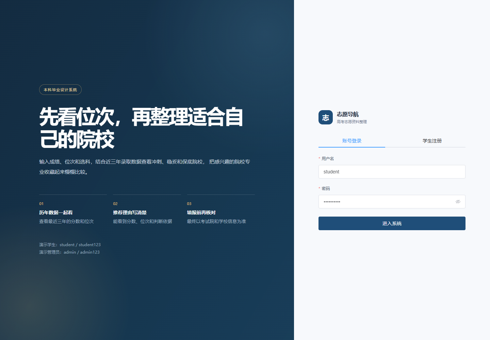
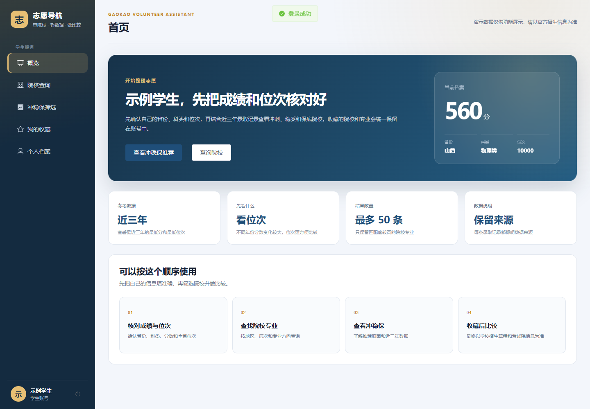
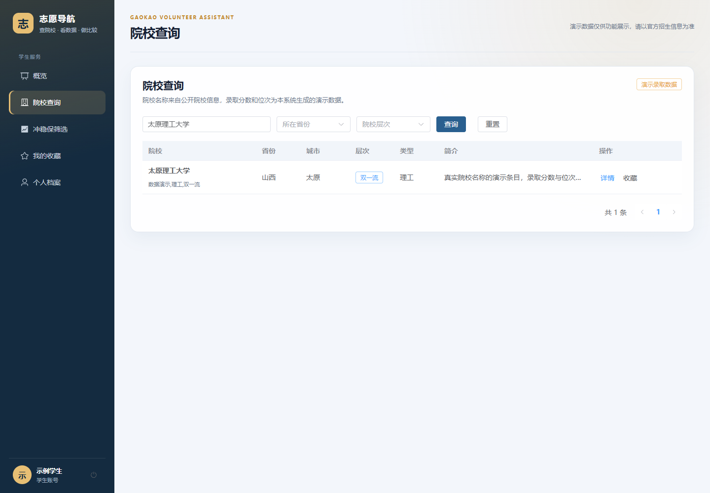
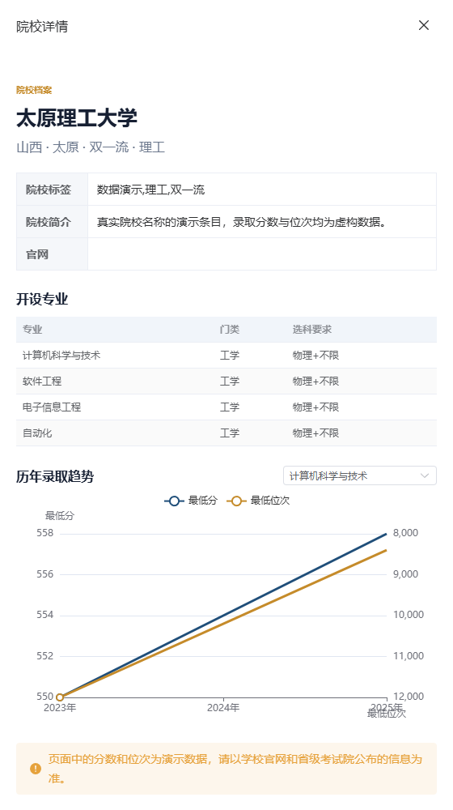
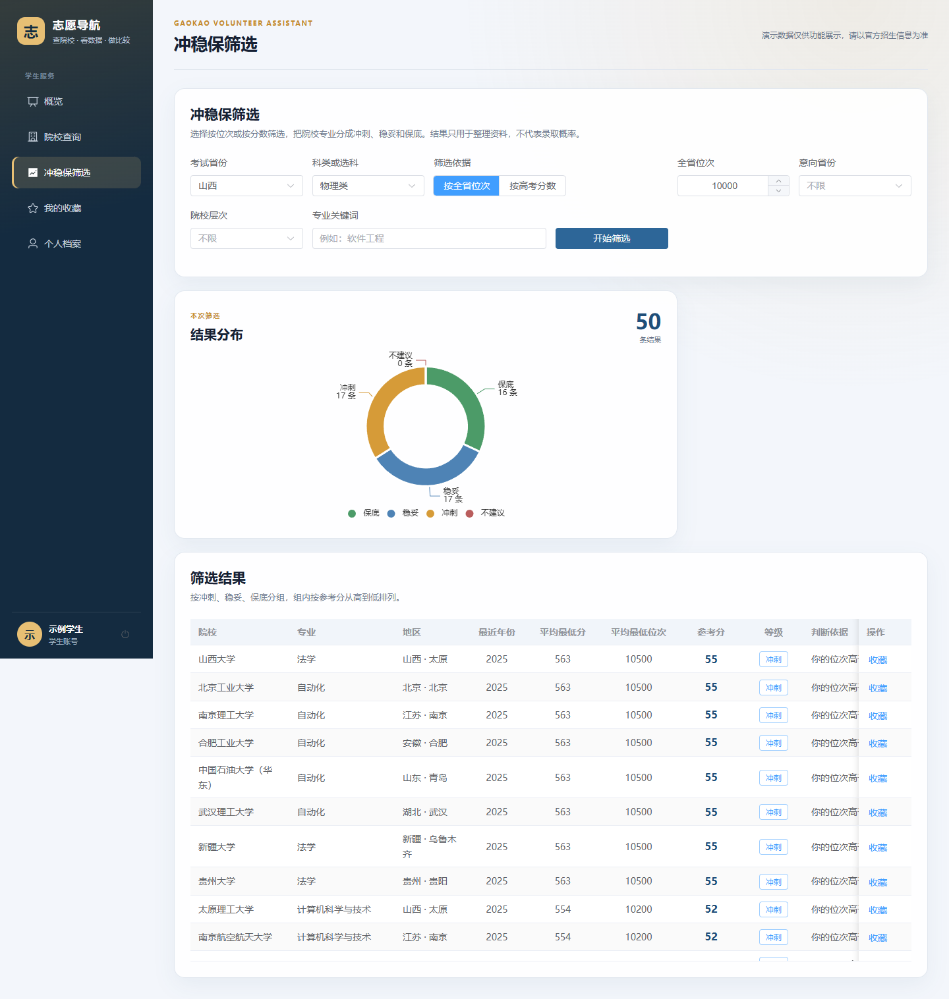
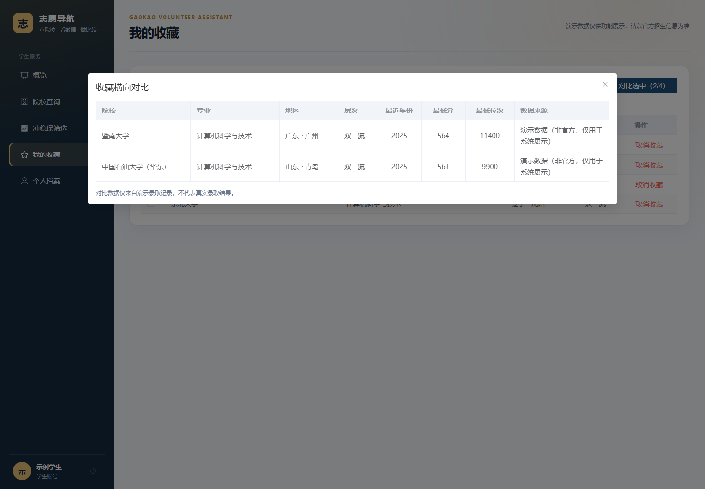
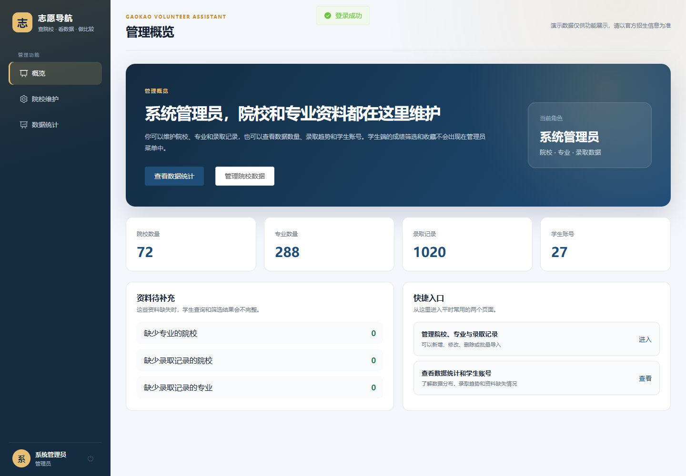
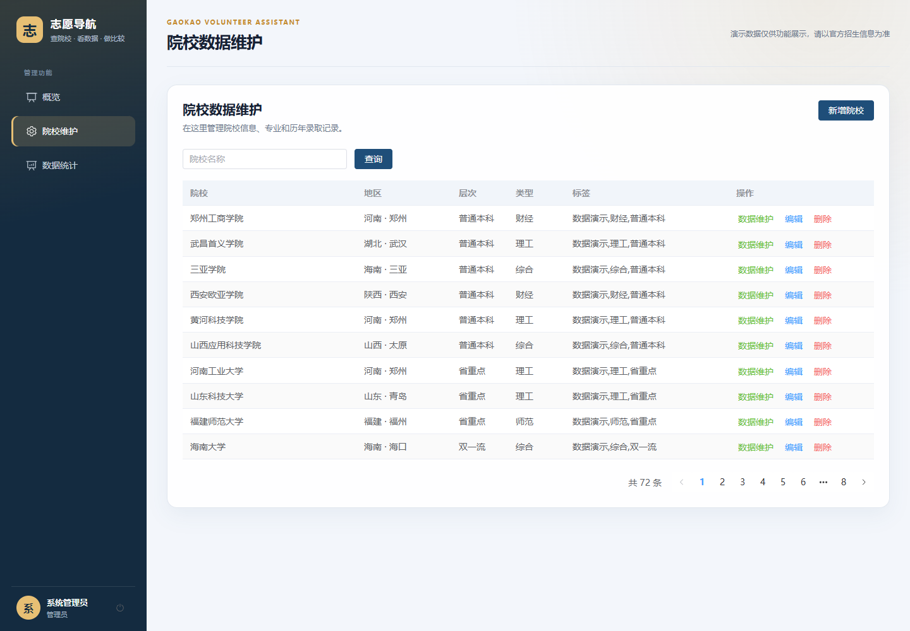
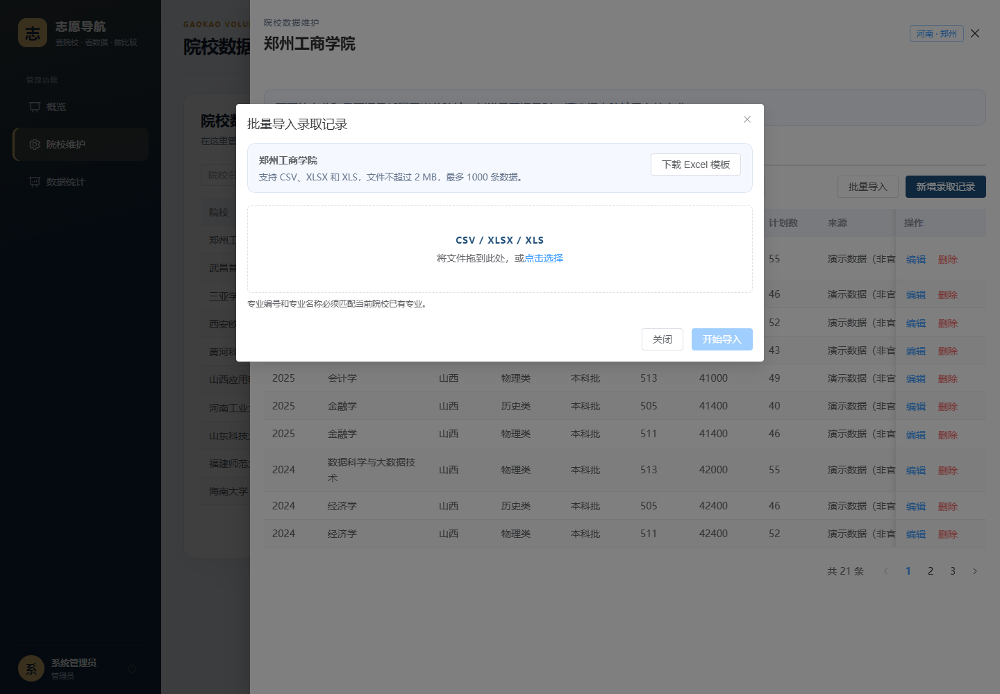
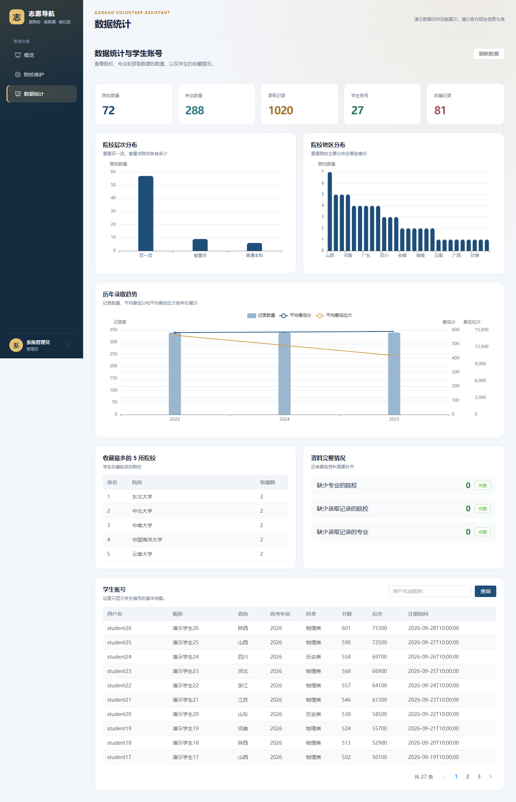

# 第5章 系统实现

第四章完成了系统架构、功能模块、数据库和关键流程设计。本章按照系统运行环境和主要业务模块说明具体实现，包括便携开发环境、登录权限、统一异常处理、学生端查询与筛选、收藏对比，以及管理端数据维护、批量导入和统计页面。文中截图来自当前运行的演示环境，录取分数、位次和收藏关系均为演示数据。

## 5.1 开发环境与项目结构

### 5.1.1 便携开发环境

为减少电脑全局环境差异对项目运行的影响，系统将 JDK、Maven、Node.js、MySQL 和 Redis 安装在项目根目录的 `dev-environment/` 中。启动脚本只在当前 PowerShell 进程设置临时环境变量，不修改系统 PATH，也不注册 Windows 服务。项目使用的固定版本如表 5-1 所示。

表 5-1 便携开发环境组件与版本

| 组件 | 版本 | 主要用途 |
| --- | --- | --- |
| Eclipse Temurin JDK | 17.0.21+9 | 编译和运行 Spring Boot |
| Apache Maven | 3.9.9 | 管理后端依赖、测试和构建 |
| Node.js | 20.18.1 | 安装前端依赖并运行 Vite |
| MySQL Community Server | 8.0.34 | 保存系统业务数据 |
| Redis for Windows | 5.0.14.1 | 本地演示冲稳保结果缓存 |

开发环境提供 `setup-environment.ps1`、`start-all.ps1`、`stop-all.ps1`、`start-backend.ps1`、`start-frontend.ps1` 和 `verify.ps1` 等脚本。首次配置会检查或下载固定版本运行时、初始化数据库、导入演示数据、安装前端依赖并执行后端测试；日常运行使用 `start-all.ps1` 同时启动 MySQL、Redis、Spring Boot 和 Vite。

MySQL 使用项目专用数据目录和 `3307` 端口，Redis 使用 `6380` 端口，后端监听 `8080`，前端监听 `5173`。数据库、Redis 和日志均放在 `dev-environment/` 下，复制完整项目目录后可以继续使用已有数据。

### 5.1.2 代码目录

后端位于 `02_项目代码/volunteer-backend/`。Controller 负责接收请求，Service 和 Service 实现类负责业务处理，Mapper 负责数据库访问，DTO 接收前端参数，VO 返回页面数据，Entity 对应数据库实体。JWT、请求上下文、统一响应和异常处理分别放在 `util/`、`common/` 和 `config/` 目录。

前端位于 `02_项目代码/volunteer-frontend/`。`views/` 保存登录、学生端和管理端页面，`api/` 保存接口调用，`utils/` 保存请求封装、图表转换、表单转换和收藏对比逻辑，`router/` 保存路由与角色限制，`stores/` 使用 Pinia 保存登录状态，`layout/` 保存整体页面框架。数据库脚本、接口文档和测试说明统一放在 `02_项目代码/database/` 和 `02_项目代码/docs/`。

## 5.2 公共功能实现

### 5.2.1 登录、JWT 与前端会话

学生注册时，后端先检查用户名是否已存在，再使用 BCrypt 对密码进行哈希，将角色固定为学生并保存档案信息。登录时根据用户名读取用户记录，使用 `PasswordEncoder.matches` 校验密码。用户名不存在和密码错误返回相同提示，避免通过错误信息判断账号是否存在。

登录成功后，`JwtUtil` 生成包含用户名、用户编号和角色的 JWT，默认有效期为 720 分钟。前端登录页调用认证接口，将令牌和脱敏用户信息写入 Pinia 和 `localStorage`。登录页面如图 5-1 所示。

Axios 请求拦截器在每次请求前读取本地令牌，写入 `Authorization: Bearer ...` 请求头。响应拦截器检查统一响应中的业务代码，遇到未登录状态时清理本地令牌和用户信息，并返回登录页。该处理使各业务页面不需要分别编写登录失效逻辑。

Vue Router 根据路由元数据检查公开页面和角色要求。未登录用户访问业务页面时跳转到登录页，学生访问管理员页面或管理员访问学生页面时返回概览页。前端路由控制页面入口，后端拦截器和接口角色检查负责真正的数据权限，两者不能互相替代。

### 5.2.2 统一响应与异常处理

后端使用 `ApiResponse<T>` 封装普通接口结果，包含业务代码、消息、数据和响应时间。成功请求的业务代码为 0；业务异常使用 400、401、403 和 404 表示参数错误、未登录、无权限和资源不存在；未知异常返回 500。前端响应拦截器统一弹出错误消息，并在业务成功时只向页面返回 `data` 部分。

参数校验主要使用 Bean Validation。例如登录和注册校验用户名、密码和昵称，更新档案校验年份、分数和位次，推荐请求要求分数或位次至少填写一项，管理员保存录取记录时校验专业、年份、分数和位次。`GlobalExceptionHandler` 将 `MethodArgumentNotValidException`、`BindException`、约束违反、请求体格式错误和上传文件超限转换为中文提示，并把未知异常写入日志。

列表接口使用 `PageResult<T>` 返回当前页数据、总记录数、当前页码和每页数量。Entity 不直接返回前端：院校列表转换为 `UniversityVO`，院校详情组合 `UniversityDetailVO`，收藏和推荐也使用独立 VO。这样既隐藏密码哈希等内部字段，也避免页面因数据库字段变化而直接失效。

### 5.2.3 缓存实现

项目启动类启用 Spring Cache 注解。推荐服务在 `recommend` 方法上使用 `@Cacheable`，缓存名称为 `recommendations`，缓存键由考试省份、年份、科类、分数、位次、意向省份、院校层次和专业关键词组成。

默认 `application.yml` 使用本地简单缓存，便于只启动后端进行开发。`application-redis.yml` 将缓存类型切换为 Redis，连接项目便携 Redis，并设置 10 分钟有效期且不缓存空值。院校、专业、录取记录和批量导入的写操作使用 `@CacheEvict(value = "recommendations", allEntries = true)` 清理推荐缓存，避免页面读取修改前的聚合结果。

## 5.3 学生端功能实现

### 5.3.1 学生首页与个人档案

学生登录后进入学生首页，页面根据角色显示学生导航，并提供院校查询、冲稳保筛选、收藏和个人档案入口。学生首页如图 5-2 所示。

个人档案页面使用 Element Plus 表单维护昵称、考试省份、年份、科类、分数和全省位次。页面加载时从 Pinia 中的当前用户读取初始值，保存后调用档案更新接口，并使用返回的 `UserVO` 更新本地用户信息。表单对昵称、省份和科类设置必填校验，年份、分数和位次使用数字输入范围限制。

个人档案既可以在页面中单独维护，也会作为冲稳保筛选的默认条件。页面提示不同年份的试题难度和分数线会变化，因此比较位次通常比直接比较分数更稳定。该提示只说明使用方式，不构成录取建议。

### 5.3.2 院校查询与详情趋势

院校查询页面调用分页接口，支持院校名称关键词、所在省份、院校层次和页码条件。后端将关键词同时匹配院校名称、简介和标签，再按省份和层次追加等值条件，使用 MyBatis-Plus 分页查询后转换为 `UniversityVO`。前端表格展示院校、地区、层次、类型和标签，底部使用分页组件切换页面。院校查询页面如图 5-3 所示。

点击院校详情后，前端调用 `GET /api/universities/{id}/overview`，并携带当前学生的省份和科类。后端一次返回院校信息、专业列表和录取记录，避免页面逐专业发起请求。前端将专业放入选择器，再使用 `buildAdmissionTrendOption` 过滤当前专业并按年份升序生成 ECharts 双轴折线图。

趋势图左轴表示最低分，右轴表示最低位次，位次轴设置为反向，使用户能够直观看到数值变小时排名提高。当前专业没有录取记录时，转换函数返回居中的空状态文字，而不是生成空白坐标系。组件关闭或卸载时释放图表实例，重新渲染前清理旧配置。院校详情与趋势如图 5-4 所示。

### 5.3.3 冲稳保筛选

冲稳保页面提供省份、年份、科类、筛选依据、分数或位次、意向省份、院校层次和专业关键词。`buildRecommendationPayload` 根据“按高考分数”或“按全省位次”模式只提交一项数值，另一项显式置空。切换科类、筛选依据、地区、层次或关键词时，页面立即清空上次查询结果，防止旧数据与新条件混淆。

点击开始筛选后，后端查询考试年份前三年的录取记录，按院校编号和专业编号聚合平均最低分和平均最低位次，再调用评分方法生成参考分、等级和判断依据。前端使用环形图展示不同等级数量，使用表格展示院校、专业、地区、年份、平均最低分、平均最低位次、参考分、等级和判断依据。页面同时显示数据来源限制。冲稳保结果如图 5-5 所示。

查询结果较多时，后端最多返回 50 条。结果选择器先为存在的冲刺、稳妥和保底分组分配名额，某一等级不足时由其他等级补位，避免列表被同一等级占满。无匹配结果时，饼图和表格分别显示空状态；图表重绘前调用 `clear()` 清除旧图形，防止上一次查询的空状态文字残留在新图表中。

### 5.3.4 收藏与横向对比

收藏新增接口先检查院校是否存在，再检查专业是否属于该院校。查询重复收藏时，应用层分别判断整校收藏和专业收藏，避免数据库唯一索引对空专业编号的处理差异造成重复数据。收藏列表只按当前登录用户编号查询，取消收藏时再次校验收藏所属用户，防止通过记录编号操作其他用户的数据。

前端收藏表格支持多选，只允许同时选择 2 至 4 项。开始对比后，页面按院校编号去重并并行请求院校详情，再由 `buildComparisonRows` 选择对应专业的最新录取年份、最低分、最低位次和数据来源。某一院校详情加载失败时，失败项保留原收藏信息并显示加载失败，其他项继续展示。收藏横向对比如图 5-6 所示。

## 5.4 管理端功能实现

### 5.4.1 管理概览与导航

管理员登录后进入独立管理概览。左侧导航只显示管理概览、院校维护和数据统计，不出现学生端的冲稳保和收藏功能。概览读取院校、专业、录取记录、学生账号和收藏总量，并提供进入院校维护和数据统计的快捷入口。管理概览如图 5-7 所示。

管理端路由使用 `roles: ['ADMIN']` 限制，后端管理接口使用管理员角色注解。前端和后端同时限制，既避免管理员误入学生页面，也阻止学生通过手工输入地址或调用接口访问管理数据。

### 5.4.2 院校、专业与录取记录维护

院校维护页面使用分页表格展示院校，支持关键词查询、新增、编辑和删除。新增和编辑使用同一表单组件，保存前校验院校名称、省份、城市和层次。删除操作先要求用户确认，后端随后检查该院校下是否仍有专业、录取记录和收藏；存在关联数据时返回中文提示，不允许直接删除。

点击“数据维护”打开当前院校的抽屉，其中分为专业和录取记录两个页签。专业页签支持查询、新增、编辑和删除，专业始终属于当前院校。录取记录页签支持按年份、省份、科类和批次筛选，新增时必须从当前院校的专业列表选择具体专业。后端校验专业归属、年份范围、分数、位次、计划数和同专业同年份省份科类批次的重复记录。院校数据维护页面如图 5-8 所示。

专业已被录取记录或收藏引用时不能删除，院校仍存在下属数据时不能删除。页面为加载、空数据、保存中和无专业可选状态提供不同提示，避免管理员在未选择专业时反复提交无效请求。

### 5.4.3 CSV 与 Excel 批量导入

批量导入弹窗提供 Excel 模板下载和文件选择。模板由 Apache POI 生成，包含专业编号、专业名称、招生省份、年份、科类、批次、最低分、最低位次、计划数和数据来源，并使用当前院校第一条专业生成示例行。管理员上传 CSV、XLSX 或 XLS 后，后端根据扩展名选择解析器。

CSV 解析处理 UTF-8 BOM、逗号分隔和引号字段；XLSX 和 XLS 读取普通文本、数字及公式单元格结果。文件解析后先按表头名称映射字段，允许表头顺序变化，但要求必填列齐全且不能重复。文件大小限制为 2 MB，数据行最多 1000 条。

逐行校验包括专业存在且属于当前院校、专业名称与编号一致、年份范围、分数范围、位次为正数、计划数非负，以及数据库和当前文件内的重复记录。合法行写入数据库，错误行不写入并返回真实文件行号、专业编号、专业名称和中文原因。导入完成后清理推荐缓存。录取记录导入界面如图 5-9 所示。

### 5.4.4 数据统计与学生账号

数据统计接口先读取院校、专业、录取记录、收藏和学生账号数据，再在内存中进行分组、平均值和排行计算，避免逐院校查询造成大量重复 SQL。页面展示院校、专业、录取记录、学生账号和收藏五个指标，以及院校层次分布、地区分布、年度录取趋势、收藏最多的 5 所院校和数据完整情况。

完整情况分别统计没有专业的院校、没有录取记录的院校和没有录取记录的专业。年度趋势计算每一年的记录数、平均最低分和平均最低位次。图表使用 ECharts，页面监听窗口变化调整尺寸，组件卸载时释放图表实例。

学生账号列表只查询 `STUDENT` 角色，支持用户名或昵称关键词和分页，返回用户名、昵称、省份、年份、科类、分数、位次和注册时间等字段，不包含密码哈希。数据统计与学生账号页面如图 5-10 所示。

## 5.5 运行与验证实现

项目根目录提供 VS Code 共享配置。推荐插件覆盖 Java、Vue 和 PowerShell，任务面板提供首次配置、一键启动、停止、完整验证、前端启动、后端启动和调试准备。Java 调试配置使用项目内 JDK，并先停止旧服务、启动数据库和前端，再以调试模式启动 Spring Boot，减少端口占用和网页依赖服务未启动的问题。

`verify.ps1` 依次检查运行时版本、MySQL 和 Redis 端口、后端和前端端口、业务表数量、Redis 响应、院校查询、学生登录、管理员登录、冲稳保筛选、收藏查询和前端登录页。验证脚本在任一步失败时终止，不把部分成功状态标记为整体通过。

项目使用 Maven 测试后端服务与文件解析，使用 Vitest 测试前端图表转换、筛选表单、收藏对比、管理统计和角色导航。前端通过 Vite 生成生产资源。测试环境、用例和结果将在第六章统一整理。

## 5.6 本章小结

本章说明了系统从架构设计到具体实现的落地过程。系统使用项目内便携环境统一 JDK、Maven、Node.js、MySQL 和 Redis，前端以 Vue 3 实现页面、路由、状态和图表，后端以 Spring Boot 分层实现接口、业务和数据库访问。

公共功能方面，完成了 BCrypt 密码校验、JWT 登录、前后端角色限制、Axios 拦截、统一响应、异常处理、分页对象和推荐缓存。学生端实现了个人档案、院校查询、详情趋势、单条件冲稳保筛选、收藏和两至四项对比；管理端实现了角色概览、院校专业录取记录维护、CSV 与 Excel 导入、数据统计和脱敏学生账号。

页面截图和代码实现表明，第三章确定的主流程已经能够在当前便携环境中运行。下一章将从测试环境、测试用例、自动化结果和异常场景等方面对系统进行验证。
