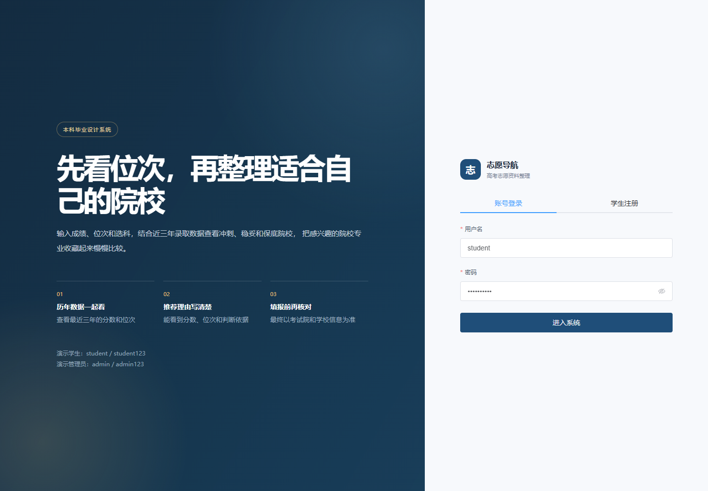
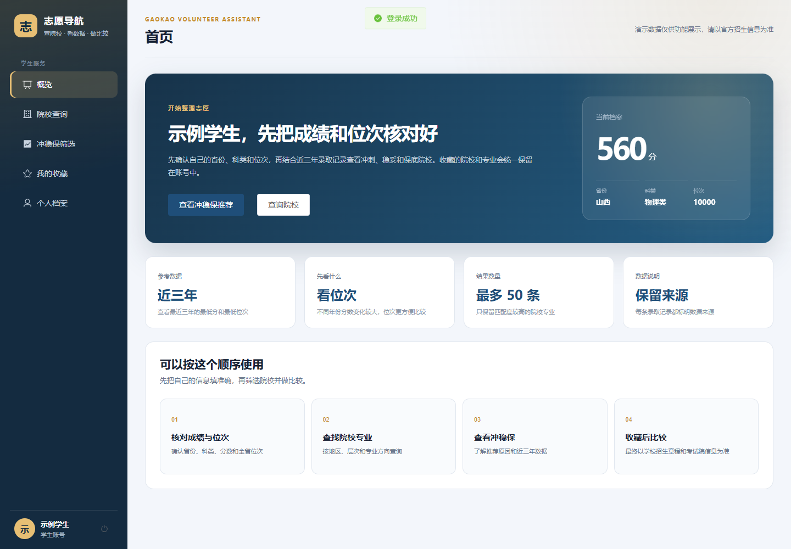
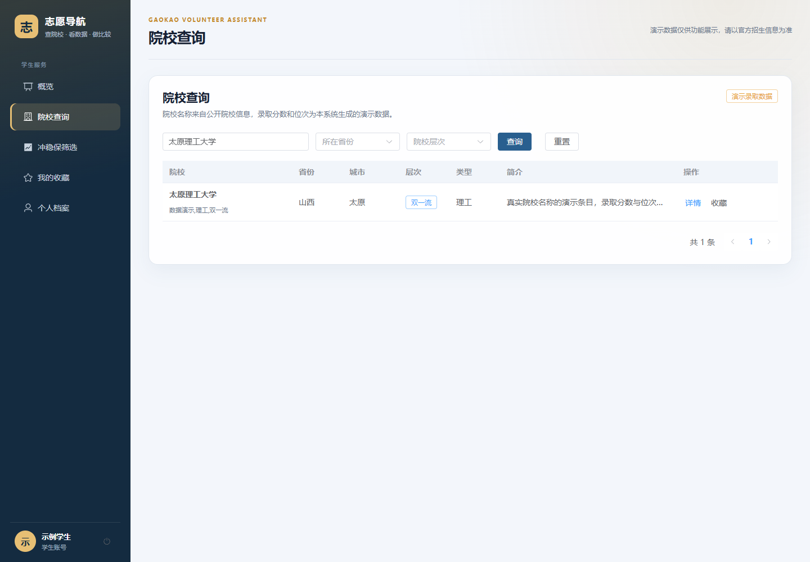
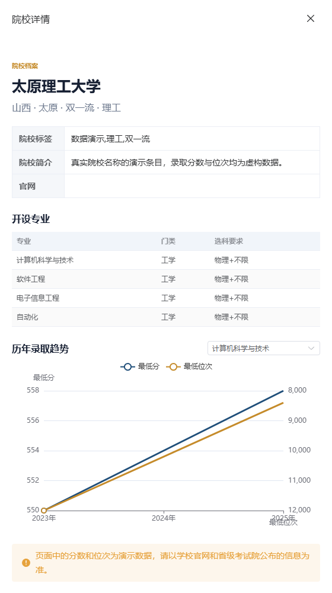
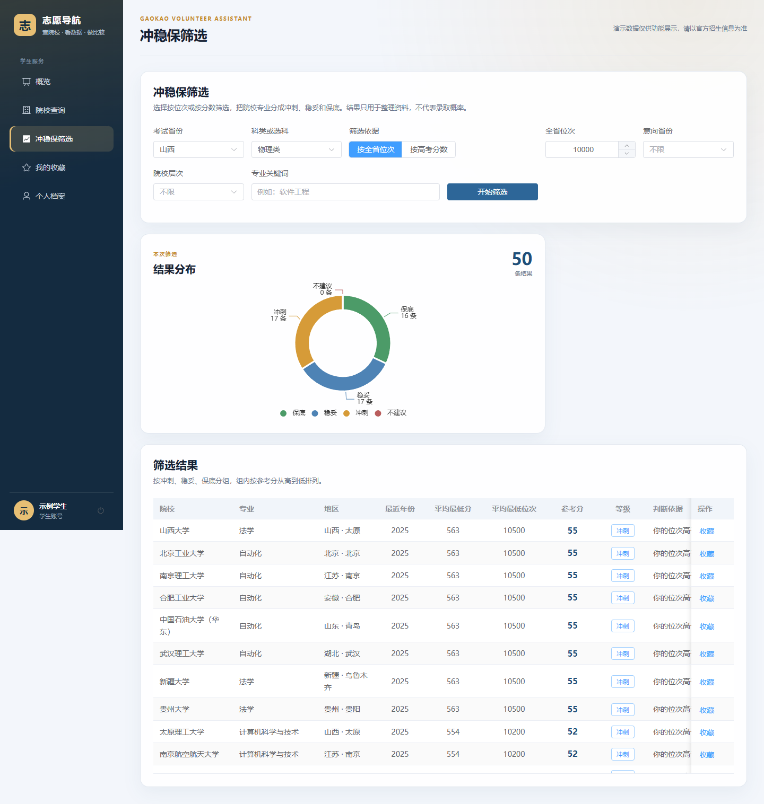
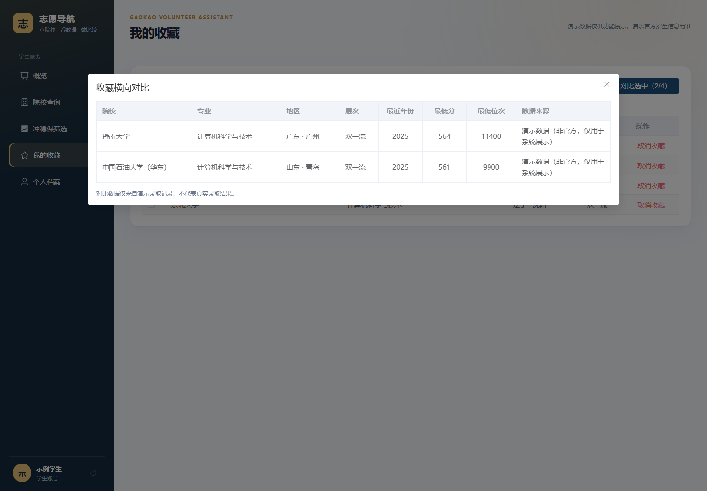
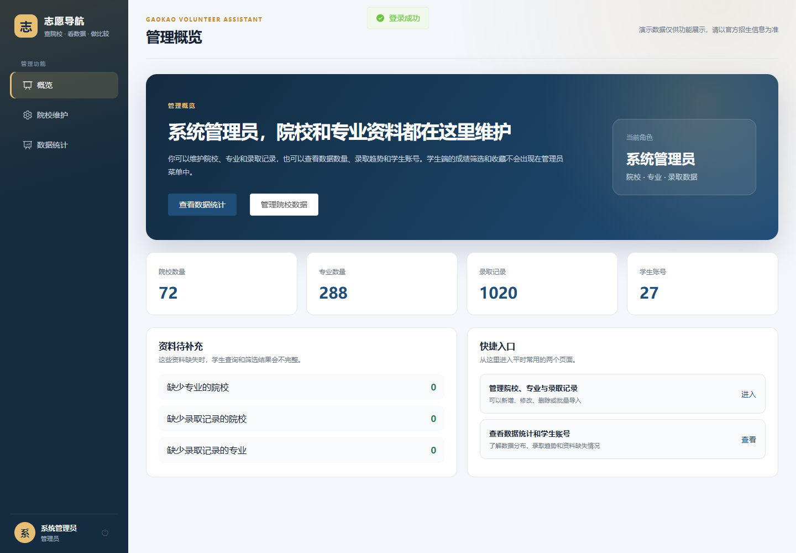
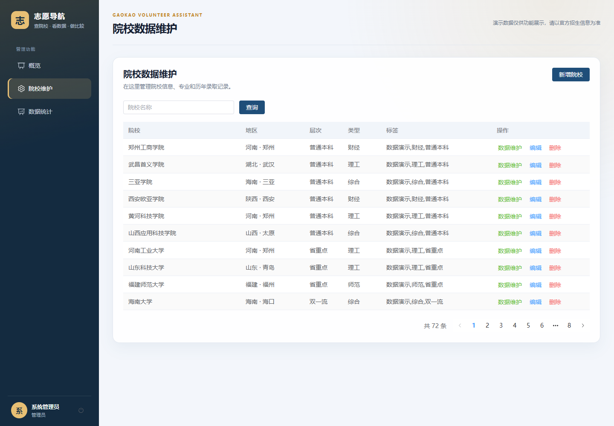
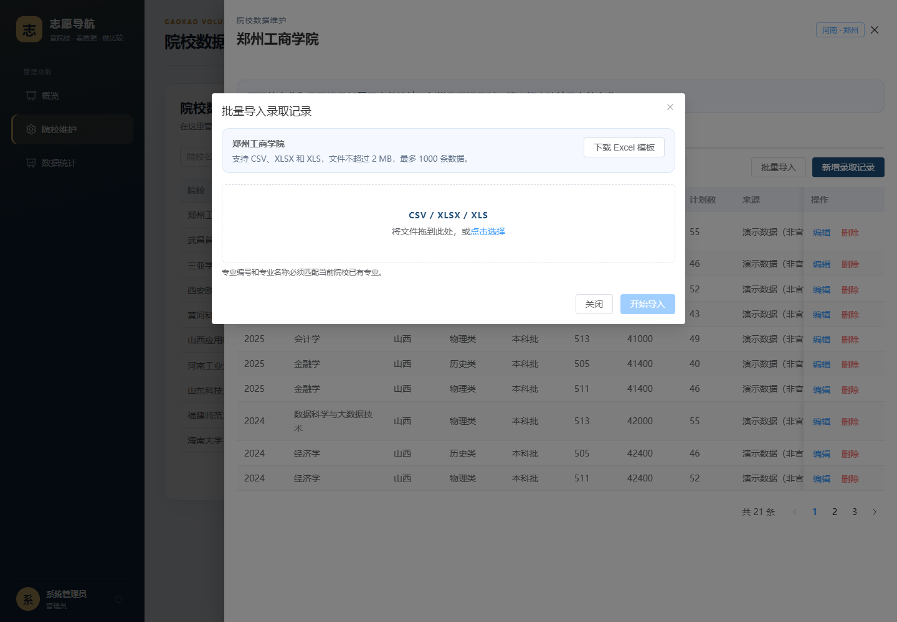
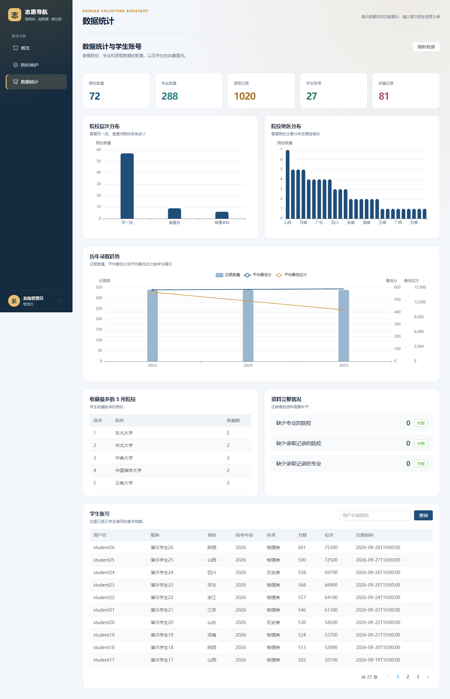

# 基于 Spring Boot 和 Vue 的高考志愿填报辅助系统设计与实现

## 摘 要

高考志愿填报需要综合考试成绩、全省位次、招生省份、选科要求、院校层次、专业方向和历年录取数据。相关信息来源分散，统计口径和查询入口不一致，考生在整理候选院校时容易重复查找、遗漏条件或把单项分数直接当作录取依据。为提高志愿资料的整理效率，本文设计并实现了一个基于 Spring Boot 和 Vue 的高考志愿填报辅助系统，为学生提供院校专业查询、录取趋势查看、冲稳保辅助筛选和收藏对比，为管理员提供基础数据维护、批量导入和统计功能。

系统采用 B/S 架构和前后端分离模式。后端使用 Java 17、Spring Boot 3 和 MyBatis-Plus，前端使用 Vue 3、Element Plus 和 ECharts，MySQL 保存用户、院校、专业、录取记录和收藏，Redis 缓存推荐结果。系统使用 JWT 和角色拦截区分学生与管理员权限，使用 BCrypt 保存密码哈希，通过统一响应、参数校验和异常处理返回操作结果。学生端以考试省份、年份、科类和选科组合为基础，支持按全省位次或高考分数单选条件筛选；后端读取近三年录取记录，按院校专业计算平均最低分、平均最低位次和参考分，再划分冲刺、稳妥和保底。管理端以院校为入口维护专业和录取记录，并支持 CSV、XLSX、XLS 批量导入、逐行错误反馈、数据统计和脱敏学生账号查看。

系统使用 72 所院校、288 个专业、1020 条录取记录、27 个学生账号和 81 条收藏进行演示。测试结果表明，后端 58 项自动化测试和前端 30 项自动化测试全部通过，前端生产构建成功，便携环境能够启动 MySQL、Redis、后端和前端并完成登录、院校查询、冲稳保筛选和收藏查询。物理类按位次和按分数两种模式均返回冲刺 17 条、稳妥 17 条、保底 16 条，40 次单用户顺序接口请求全部成功。系统实现了从资料查询、历史趋势、条件筛选到收藏对比的主流程，但录取数据仍为演示数据，推荐结果只表示历史数据匹配程度，不构成录取概率或正式填报结论。

关键词：Spring Boot；Vue；高考志愿填报；历史录取数据；辅助决策

## Abstract

College application requires students to consider examination scores, provincial rankings, admission provinces, subject requirements, university levels, major preferences, and historical admission records. Because this information is distributed across different notices, websites, and data files, candidates often need to search repeatedly and may treat a single score comparison as sufficient evidence for application decisions. This thesis designs and implements a college application assistance system based on Spring Boot and Vue. The system helps students search for universities and majors, review historical admission trends, filter candidates into rush, stable, and safe groups, and compare favorite choices. It also provides administrators with university data maintenance, batch import, and statistics.

The system follows a browser/server architecture with separated front-end and back-end applications. The back end uses Java 17, Spring Boot 3, and MyBatis-Plus. The front end uses Vue 3, Element Plus, and ECharts. MySQL stores users, universities, majors, admission records, and favorites, while Redis caches recommendation results. JWT authentication and role checks separate student and administrator permissions, and BCrypt is used for password hashing. Unified responses, request validation, and exception handling provide consistent feedback.

The student workflow uses province, examination year, subject track, and either the provincial rank or the examination score. The back end reads admission records from the previous three years, aggregates the average minimum score and average minimum rank for each university-major pair, calculates a reference score, and classifies candidates as rush, stable, or safe. The administrator workflow maintains majors and admission records under each university. It also supports CSV, XLSX, and XLS import, row-level validation feedback, statistical charts, and desensitized student accounts.

The demonstration dataset contains 72 universities, 288 majors, 1,020 admission records, 27 student accounts, and 81 favorite records. All 58 back-end tests and 30 front-end tests passed, the production build succeeded, and the portable environment completed the main login, university query, recommendation, and favorite flows. Both rank-based and score-based filtering returned 17 rush, 17 stable, and 16 safe results. Forty sequential single-user API requests completed without errors.

The system covers the main workflow from information search and historical trend review to conditional filtering and favorite comparison. The current admission records are demonstration data rather than official admission results. The recommendation output reflects relative similarity to historical data and does not estimate admission probability or replace verification against official examination authority and university notices.

Keywords: Spring Boot; Vue; college application; historical admission data; decision support

---

# 目 录

1. 摘 要
2. Abstract
3. 第1章 绪 论
4. 第2章 相关技术
5. 第3章 需求分析
6. 第4章 系统设计
7. 第5章 系统实现
8. 第6章 系统测试与结果分析
9. 结 论
10. 参考文献

---

# 第1章 绪 论

## 1.1 研究背景与意义

高考志愿填报是高中毕业生进入高校前需要完成的重要选择。考生既要考虑分数和全省位次，还要核对招生省份、科类或选科要求、批次、院校层次、专业方向和历年录取情况。不同省份的高考模式、志愿单位和投档规则存在差异，相关说明又分散在考试院通知、院校招生网和招生计划材料中。考生在有限时间内完成信息收集、条件比较和志愿排序，容易出现信息遗漏或仅凭单项分数判断的问题。

国务院《关于深化考试招生制度改革的实施意见》提出逐步推行综合评价、多元录取等改革方向，考试招生制度更加重视学生选择与高校人才选拔的匹配[1]。随着新高考模式推进，专业选科要求、院校专业组和不同批次规则进一步增加了志愿信息的复杂度。教育部在部署高考志愿填报咨询服务时，要求各地提供权威的往年录取数据、当年计划数据查询和志愿备选等服务[2]。这说明使用信息系统整理公开招生资料已经成为志愿咨询服务的一部分，但系统提供的结果仍应以官方发布信息为准。

开发高考志愿填报辅助系统具有实践意义。对学生而言，系统可以把院校查询、专业查看、历年趋势、冲稳保筛选和收藏对比放在同一业务流程中，减少在多个页面之间重复查找和手工制表。对管理员而言，系统能够集中维护院校、专业和录取记录，通过批量导入和逐行错误提示降低基础数据维护成本。对毕业设计而言，系统涉及前后端分离、数据库设计、身份认证、缓存、文件解析、分页查询和测试等本科软件工程知识，适合作为一项完整的工程实践。

本课题不把系统定位为志愿决策替代工具。系统只根据演示历史数据整理候选院校，展示参考分、冲稳保等级和判断依据，不计算或承诺录取概率。最终填报仍需考生核对省级考试院和院校官网发布的招生计划、选科要求、批次和录取规则。明确这一边界，可以避免把数据查询和规则筛选误认为正式录取结论。

## 1.2 国内外研究现状

### 1.2.1 国内研究现状

国内围绕高考志愿信息化的研究主要包括管理信息系统、数据挖掘、机器学习和推荐算法等方向。刘明奇等设计了基于 B/S 结构、Java Web 和 MySQL 的高考志愿填报辅助决策系统，重点解决院校专业信息查询和志愿选择中的信息不对称问题[3]。这类研究说明，使用常见的 Web 技术和关系数据库能够完成院校、专业和录取数据的基本组织，系统结构也便于高校开发者理解。

随着招生数据规模增加，研究者开始使用数据分析和智能算法改进志愿推荐。余奎锋等提出基于多特征权重模糊聚类的志愿推荐算法，将考生特征和院校数据进行匹配[6]。周奕研究了基于机器学习的高考志愿智能推荐技术[7]，宋时雨进一步研究个性化推荐方法[8]。这些工作关注推荐结果、算法准确性和用户偏好，说明单一分数线比较难以满足志愿选择需要。

近年的研究开始引入 LSTM、数据挖掘和大数据统计。宋建铭等设计了基于 LSTM 的高考志愿决策系统，通过模型训练、数据处理和可视化提供选报建议[5]。李德铭等从高校招生管理角度设计辅助决策系统，使用数据挖掘分析招生计划、分数线和专业设置等问题[4]。这些研究提高了数据处理和预测能力，但也带来模型训练、数据质量、结果解释和维护成本等新问题。

从系统实现角度看，已有研究已经覆盖 Java Web、B/S、数据仓库、推荐算法和可视化等功能，但部分研究更重视算法效果或高校招生管理，对普通考生从查询、筛选到收藏对比的完整操作闭环说明不足。部分系统依赖真实招生数据或复杂模型，不适合作为本科毕业设计直接复现。因此，本课题选择历史数据辅助匹配和规则筛选，把数据来源、筛选依据和使用限制放在页面中明确展示。

### 1.2.2 国外研究现状

国外大学选择推荐研究更关注学生偏好、院校特征和推荐算法评价。Mokarrama 等使用基于内容的推荐方法，根据考试成绩、学费、院校评分和排名等指标为孟加拉国学生推荐私立大学，并采用准确率、召回率和 F1 值评价推荐结果[9]。该研究表明，院校推荐可以转化为多指标匹配问题，但权重和数据口径会直接影响推荐结果。

Elahi 等开发并评价了大学推荐系统，通过离线实验和在线用户研究比较不同算法在准确性、多样性、个性化感受、满意度和新颖性方面的表现[10]。该研究强调，高选择成本场景不能只关注短期点击或单一准确率，还需要考虑结果多样性和用户理解。

Delahoz-Domínguez 等将学业成绩和社会经济变量结合，使用多种机器学习模型进行大学专业推荐，认为只使用学业数据会忽略学生所处环境对教育选择的影响[11]。Ibrahim 等则从高校招生名额分配角度，将约束满足、目标规划和公平性目标结合，用于在教师、教室和政策约束下优化招生安排[12]。这些研究说明，招生与志愿问题既可以面向学生推荐，也可以面向高校进行资源分配，两类问题使用的数据和目标并不相同。

国外研究提供了推荐算法评估、用户研究和约束建模的参考，但其招生制度、申请材料、学费和院校评价体系与中国高考存在差异。直接移植复杂机器学习模型既缺少一致的数据基础，也不利于本科阶段解释系统行为。本课题因此不追求模型复杂度，而是研究如何在统一 Web 系统中完成历史录取数据整理、单条件筛选、趋势展示和候选清单管理。

### 1.2.3 现有研究的不足与本课题切入点

综合国内外研究，可以看到三个需要处理的问题。

1. 志愿数据具有明显的省份、年份、科类、批次和专业差异，若不说明统计口径，推荐结果容易被误解为普遍适用的录取结论。
2. 复杂算法可以提高预测能力，但需要较完整的数据和训练过程。对于本科毕业设计，若算法、数据和解释不能保持一致，系统很难通过论文和答辩说明。
3. 部分系统重点展示推荐结果，对院校详情、历年趋势、收藏对比、管理员数据维护和导入错误反馈关注不足，实际使用流程不完整。

本课题从软件工程实现角度切入，在 Spring Boot 和 Vue 前后端分离架构下完成学生端与管理端主流程。推荐部分使用近三年平均最低分和平均最低位次进行相对比较，将结果划分为冲刺、稳妥和保底，并明确说明数据为演示数据。研究重点不是提出新的推荐算法，而是完成需求、架构、数据库、实现和测试之间的闭环。

## 1.3 论文主要工作

论文围绕一个可运行的志愿填报辅助系统开展以下工作。

1. 分析学生和管理员的业务需求，确定系统边界、用户角色、院校查询、专业趋势、冲稳保筛选、收藏对比、数据维护、批量导入和统计功能。
2. 设计 B/S 架构和前后端分离结构，划分认证权限、学生功能、管理功能和公共支撑模块，并设计用户、院校、专业、录取记录和收藏五张核心数据表。
3. 使用 Spring Boot 3、MyBatis-Plus、MySQL、Redis、Vue 3、Element Plus 和 ECharts 实现系统，加入 JWT 鉴权、角色校验、统一响应、异常处理、分页和缓存失效。
4. 构建 72 所院校、288 个专业、1020 条录取记录、27 个学生账号和 81 条收藏的演示数据，覆盖分页、趋势、筛选、导入和统计场景。
5. 使用 JUnit 5、Mockito、Vitest、Maven 和 Vite 完成自动化测试、生产构建、便携环境验证和本机接口响应时间测试。
6. 整理需求图、架构图、ER 图、流程图、系统截图、测试矩阵和答辩素材，使论文描述与实际系统保持一致。

实现过程中把数据真实性作为边界。院校名称来自公开院校信息，录取分数、位次、计划数和收藏关系为明确标注的演示数据。系统不提供自动抓取全国招生数据、精确录取概率、在线支付、志愿代填和复杂机器学习预测。

## 1.4 论文组织结构

论文共分 6 章，结论不编章号。

第1章为绪论，说明研究背景、意义、国内外研究现状、论文工作和组织结构。

第2章为相关技术，介绍 Spring Boot、MyBatis-Plus、MySQL、Redis、JWT、Vue、Element Plus、ECharts 和 Apache POI 等技术及其选型依据。

第3章为需求分析，分析学生和管理员角色、业务流程、功能需求、非功能需求和可行性。

第4章为系统设计，说明总体架构、功能模块、数据库、接口、安全、推荐流程、缓存和批量导入设计。

第5章为系统实现，介绍便携开发环境、公共机制、学生端功能和管理端功能的实现过程。

第6章为系统测试与结果分析，记录测试环境、自动化测试、功能权限、异常边界、接口响应时间、构建和便携环境验证，并分析测试不足。

结论部分总结论文完成的工作，说明演示数据、并发测试和端到端自动化等方面的不足，并提出后续改进方向。

---

# 第2章 相关技术

系统采用 B/S 架构和前后端分离模式。后端负责业务规则、身份验证和数据访问，前端负责页面展示和交互，MySQL 保存业务数据，Redis 用于推荐结果缓存。本章介绍系统使用的 Java、Spring Boot、MyBatis-Plus、JWT、MySQL、Redis 和 Vue 等技术，并说明技术选择与本科毕业设计范围之间的关系。

## 2.1 B/S 架构与前后端分离

B/S 架构由浏览器、Web 服务器和数据服务组成。用户不需要安装专用客户端，通过浏览器访问前端页面即可使用系统。页面请求以 HTTP 形式发送到后端，后端返回 JSON 数据，前端更新页面显示。对于院校查询、表格分页、表单维护和图表展示等桌面场景，B/S 架构可以减少客户端部署工作，也便于现场演示。

前后端分离将页面代码和业务接口分开部署。前端使用 Vue 构建单页应用，后端使用 Spring Boot 提供 `/api` 接口。前端通过 Axios 统一附加身份令牌和处理错误，后端通过 Controller 接收请求并返回统一响应。该结构使页面调整不会直接修改后端业务，也便于使用接口文档和自动化测试分别验证前后端。

本系统没有采用服务端模板渲染。原因是院校筛选、收藏对比和统计图表需要在浏览器中进行较多交互，Vue 的响应式状态和组件化更适合实现表格、抽屉、弹窗和图表；同时，前后端分离能够展示接口设计、身份认证和跨域配置等本科阶段常见工程内容。

## 2.2 后端技术

### 2.2.1 Java 与 Spring Boot

后端使用 Java 17。Java 提供跨平台运行环境、面向对象语法、集合、流式处理和线程上下文等基础能力。系统实体、DTO、VO、服务和异常类型均使用 Java 实现，录取记录按院校专业分组、统计平均值和结果排序使用 Stream API 完成。

Spring Boot 3 用于构建单体后端应用。Spring Boot 提供依赖注入、自动配置、Web 请求处理、事务管理、参数校验、缓存抽象和测试支持[13]。系统通过注解声明 Controller 和 Service，通过统一配置连接 MySQL、Redis 和 JWT 参数，减少手工创建基础组件的工作。

选择单体 Spring Boot 而不是 Spring Cloud 微服务，是因为本系统由一名本科生独立完成，部署环境和数据规模有限。微服务会把用户、院校、推荐、导入和统计拆成多个进程，增加服务注册、配置、调用、日志和分布式事务成本，不利于把时间集中在主流程、论文和测试上。

### 2.2.2 Spring MVC 与 MyBatis-Plus

HTTP 请求由 Spring MVC 的 Controller 接收。Controller 使用路径、HTTP 方法、路径变量和请求体绑定 DTO，再调用 Service 完成业务。Spring MVC 与 Bean Validation 配合，可以在请求进入业务逻辑前检查必填项、长度和数值范围。

MyBatis-Plus 在 MyBatis 的基础上提供通用 Mapper、条件构造器和分页插件[14]。系统使用 `LambdaQueryWrapper` 按院校名称、省份、层次、录取年份、科类和批次组合查询，使用 `Page` 对象完成院校、录取记录和学生账号分页。Entity 与数据库表对应，DTO 和 VO 则隔离接口参数与页面返回字段。

系统保留 Controller、Service、Mapper 分层，没有把所有 SQL 和业务判断写在 Controller 中。这样做便于对推荐评分、导入校验和管理维护分别编写单元测试，也可以在论文中说明各层职责。

### 2.2.3 JWT 与密码哈希

JWT 是一种使用 JSON 声明传递信息的紧凑令牌格式，RFC 7519 定义了 JWT 的结构和声明处理方式[17]。系统生成的 JWT 包含用户名、用户编号和角色，并由后端密钥签名。请求进入受保护接口时，拦截器验证签名和有效期，再根据接口角色要求判断访问权限。

RFC 8725 给出了 JWT 实现和部署的安全建议，包括验证签名、限制令牌用途和保护密钥等[18]。系统只在令牌中放置身份和角色信息，不放置密码；令牌密钥通过配置项提供，不在前端显示。对于管理员接口，后端仍执行角色检查，不能仅依赖前端隐藏菜单。

密码不直接保存明文。系统使用 BCrypt 对注册密码进行哈希，登录时比较输入密码与哈希结果。OWASP 密码存储建议强调使用专门设计的慢哈希算法和随机盐[19]。BCrypt 自带盐并可通过成本参数增加计算时间，适合当前单体 Web 系统。

### 2.2.4 接口文档与测试

后端使用 Springdoc OpenAPI 生成接口文档，开发者可以通过 Swagger UI 查看路径、方法、参数和返回结构。接口文档用于开发联调，不作为正式安全说明，敏感字段和真实密钥不能写入文档示例。

测试使用 JUnit 5 和 Mockito。JUnit 5 负责组织测试方法和断言，Mockito 模拟 Mapper 的查询结果，使 Service 可以在不启动完整 MySQL 的情况下验证业务分支。部分测试初始化 MyBatis 元数据和使用 H2，检查条件构造器、分页对象和数据库映射。

## 2.3 数据存储技术

### 2.3.1 MySQL

系统业务数据具有明确的实体关系和条件查询需求，适合采用关系数据库。MySQL 8 支持事务、外键、索引、唯一约束和 UTF-8 字符集[15]。系统使用 `utf8mb4` 保存中文院校、专业和地区信息，通过主键关联用户、院校、专业、录取记录和收藏。

录取记录需要按招生省份、科类、年份、院校和专业查询，系统为这些字段建立索引。收藏表对用户、院校和专业建立唯一约束，避免同一用户重复收藏同一项目。关系数据库能够直接表达院校、专业和录取记录之间的一对多关系，也便于管理员页面执行引用保护。

### 2.3.2 Redis

Redis 是内存键值数据库，常用于缓存、会话和短期数据存储[16]。系统的冲稳保查询需要读取多条录取记录、按院校专业聚合和计算参考分，相同筛选条件重复查询时可以复用结果。系统因此使用 Spring Cache 注解缓存推荐结果，默认开发配置使用本地简单缓存，启用 Redis 配置时切换为 Redis。

推荐缓存键包含省份、年份、科类、分数、位次、意向省份、层次和关键词，缓存有效期为 10 分钟。院校、专业和录取记录发生变化后清理全部推荐缓存。选择按缓存名称整体失效，而不是尝试计算受影响键，是因为一条录取记录可能影响多个分数、位次和关键词组合，整体失效更容易保证一致。

## 2.4 前端技术

### 2.4.1 Vue、Vue Router 与 Pinia

Vue 3 使用组件化方式组织页面，通过响应式数据更新模板[20]。系统中的登录页、学生概览、院校查询、推荐筛选、收藏、个人档案、管理概览、数据维护和统计页面均独立为 Vue 组件。组合式 API 将表单、加载状态、分页和图表生命周期放在同一组件逻辑中，便于维护。

Vue Router 管理页面路径和导航，路由元数据记录页面标题和角色要求[21]。未登录用户访问业务页面时跳转到登录页，角色不匹配时返回对应首页。Pinia 保存当前令牌和用户信息，并同步到浏览器本地存储[22]。页面刷新后可以恢复会话，退出登录时统一清理。

前端路由限制用于改善交互，并不能替代后端权限。即使学生修改浏览器地址进入管理页面，后端仍会拒绝管理接口请求。前后端同时控制的方案能够兼顾页面体验和数据安全。

### 2.4.2 Element Plus 与 ECharts

Element Plus 提供表格、分页、表单、选择器、抽屉、弹窗、标签和消息提示等组件[23]。系统使用这些组件构建院校列表、数据维护抽屉、批量导入弹窗和管理表单，统一页面的输入方式与状态反馈。组件库减少了基础控件开发时间，使实现重点放在业务数据和交互流程上。

ECharts 用于展示专业历年最低分与最低位次、冲稳保结果分布、院校层次和地区分布、年度录取趋势。专业趋势图使用双纵轴，位次轴采用反向刻度，便于观察排名变化[24]。页面在窗口尺寸变化时调整图表，组件卸载时释放实例，重新渲染前清理旧配置，避免残留文字或内存占用。

### 2.4.3 Axios 与 Vite

Axios 封装浏览器 HTTP 请求。系统设置统一 `/api` 基础路径和 15 秒超时，在请求拦截器中附加 JWT，在响应拦截器中检查业务代码、显示中文错误并处理登录失效。页面只接收成功响应的 `data` 部分，避免每个页面重复解析统一响应结构。

Vite 提供前端开发服务器和生产构建。开发模式下修改 Vue 文件后能够快速刷新；生产构建将页面、组件和第三方库打包为静态文件。当前构建主包较大，后续可以通过路由懒加载和依赖拆包减小首屏资源。

## 2.5 文件导入技术

录取记录需要支持 CSV、XLSX 和 XLS。CSV 使用 Apache Commons CSV 解析，处理 UTF-8 BOM、逗号分隔和引号字段。Excel 文件使用 Apache POI 读取工作簿、单元格和公式计算结果，并使用同一组件生成导入模板[25]。

文件导入先检查扩展名、大小和表头，再逐行解析为统一对象。CSV 和 Excel 最终进入相同的字段校验、专业归属检查、重复检查和数据库写入流程。这样避免为不同文件格式维护不同的业务校验，也便于对解析器和导入服务分别测试。

## 2.6 开发与测试工具

项目使用 Git 进行版本控制，提交信息统一使用中文。后端使用 Maven 管理依赖、执行测试和构建，前端使用 npm 安装依赖和运行 Vite。便携开发环境把 JDK、Maven、Node.js、MySQL 和 Redis 放在项目目录内，通过 PowerShell 脚本设置当前进程环境变量。

前端单元测试使用 Vitest，直接验证图表配置、推荐表单、收藏对比、管理表单和角色导航等纯数据转换。浏览器验收使用 Chrome，通过实际登录、分页、弹窗和图表检查页面效果。该组合覆盖了数据规则、页面构建和主流程运行三个层面。

## 2.7 技术选型小结

系统技术选型以可实现、可运行、可解释和便于测试为原则。Spring Boot、MyBatis-Plus、MySQL 和 Vue 3 均是常见 Web 技术，能够支撑前后端分离、分页、认证、数据维护和图表展示；JWT、BCrypt 和统一异常处理满足基本权限与安全需求；Redis 用于有重复计算特点的推荐查询；Apache POI 和 Commons CSV 用于批量数据维护。

系统没有引入 Spring Cloud、消息队列、搜索引擎、Kubernetes 和大模型推理服务。这些技术能够解决更大规模或更复杂的问题，但会超出当前数据规模和个人开发时间。把单体应用、关系数据库和清晰分层做好，并通过测试证明主流程可用，更符合本科毕业设计的目标。

---

# 第3章 需求分析

高考志愿填报需要综合考虑考试成绩、全省位次、招生省份、选科要求、院校层次、专业方向和历史录取情况。相关数据来源分散、表头与统计口径不完全一致，学生通常需要在多个页面之间反复查找，再把院校、专业和历年分数整理到表格中。信息整理过程重复且容易遗漏，因此有必要建立一个面向学生和管理员的高考志愿填报辅助系统，把院校专业查询、历史数据展示、候选院校筛选和个人收藏对比放在同一套业务流程中。

本章从系统使用对象和业务边界出发，分析学生端、管理端的功能需求和非功能需求，并从技术、数据和实施条件三个方面说明系统建设的可行性。需求分析以当前已经实现并能够演示的功能为依据，后续系统设计、实现和测试均以本章确定的范围为基础。

## 3.1 需求来源与系统边界

### 3.1.1 需求来源

系统需求主要来自学生整理志愿信息和管理员维护基础数据两类使用场景。

学生首先需要建立包含考试省份、高考年份、科类或选科组合、分数和全省位次的个人档案。随后，学生通过院校查询了解学校所在地区、院校层次和办学类型，通过院校详情查看具体专业以及近三年的最低分、最低位次变化。为了缩小候选范围，学生可以只填写分数或位次中的一项，让系统按历史录取数据整理冲刺、稳妥和保底院校；对于感兴趣的院校或专业，还可以加入收藏，并在收藏列表中选择两至四项进行横向比较。

管理员负责维护系统运行所依赖的院校、专业和录取记录。由于录取记录数量较多，逐条录入效率较低，系统需要提供批量导入、模板下载、错误行提示和部分成功处理能力。同时，管理员还需要查看院校层次、地区分布、年度录取趋势、收藏排行和数据完整情况，以便发现缺少专业或缺少录取记录的院校。学生账号列表用于了解注册用户的基本情况，页面不展示密码等敏感字段。

### 3.1.2 系统服务对象

系统设置学生和管理员两类角色。学生是志愿资料整理功能的主要使用者，只能访问学生端页面并操作本人的档案、收藏和对比数据。管理员负责基础数据管理和统计查看，不参与学生的志愿筛选流程。两类角色进入系统后显示不同的导航菜单，访问不属于自身角色的页面时返回对应首页，避免学生误入管理功能，也避免管理员在学生页面中执行数据操作。

系统服务对象及主要用例如图 3-1 所示。

> 图 3-1 系统用例图
> 图源：`01_论文材料/03_需求与系统设计/图表/01_用例图.mmd`

### 3.1.3 系统边界

本系统定位为志愿信息整理和历史数据辅助筛选工具，不替代省级考试院、招生院校发布的官方招生计划和录取规则。系统的使用边界包括以下四个方面。

1. 系统只处理普通本科场景下的院校、专业和录取记录，不覆盖艺术类、体育类、强基计划、专项计划等特殊招生类型。
2. 当前演示版本中的录取分数、最低位次和计划数为明确标注的非官方演示数据，用于展示查询、筛选、统计和导入流程，不能作为真实填报依据。
3. 冲稳保结果只表示候选院校与历史录取数据之间的相对关系，不表示被录取的概率，也不构成填报承诺。
4. 系统不提供在线缴费、志愿代填、自动抓取全国招生数据和复杂机器学习预测，用户最终仍需核对考试院和院校官网信息。

上述边界既控制了本科毕业设计的实现规模，也能够避免把演示数据或规则筛选结果误认为正式录取结论。

## 3.2 用户角色与业务流程

### 3.2.1 学生角色

学生进入系统后，可以通过用户名和密码注册、登录，并在个人档案中维护考试省份、高考年份、科类或选科组合、分数和全省位次。档案信息用于院校详情和冲稳保筛选的初始条件，学生也可以根据本次查询需要临时调整省份、科类、筛选依据和意向地区。

院校查询支持关键词、所在省份、院校层次和分页条件。学生打开院校详情后，可以查看院校所在城市、院校层次、专业列表以及同一专业在不同年份的最低分和最低位次。对于感兴趣的院校或专业，学生可以加入收藏，并在收藏页面选择两至四项生成横向对比，比较地区、层次、最近年份、最低分和最低位次。

学生端的操作重点是“填写条件、查找院校、查看趋势、整理候选清单”。系统不替学生决定志愿顺序，只把分散的数据整理成便于比较的结果。

### 3.2.2 管理员角色

管理员登录后进入管理概览，可以查看院校、专业、录取记录、学生账号和收藏记录的数量，并从概览进入院校维护或数据统计页面。

院校维护以院校列表为入口。管理员可以新增、编辑和删除院校；进入某所院校的数据维护页面后，可以继续维护该校专业和录取记录。新增专业时必须填写所属院校、专业名称、门类、选科要求和简介。新增录取记录时必须选择当前院校下的具体专业，并填写招生省份、年份、科类、批次、最低分、最低位次、计划数和数据来源。修改或删除院校、专业和录取记录后，系统需要同步清理可能受影响的冲稳保缓存，避免页面继续显示旧数据。

对于批量数据，管理员可以下载当前院校的 Excel 模板，上传 CSV、XLSX 或 XLS 文件。系统先检查文件格式、表头和字段，再逐行检查专业归属、年份、分数、位次、计划数和重复记录。合法行可以写入数据库，错误行需要返回真实行号、专业信息和中文原因。单行错误不能导致整个导入过程无提示终止。

### 3.2.3 学生业务主流程

学生端主流程为：进入系统并登录，维护个人档案；选择按全省位次或按高考分数筛选；系统读取符合省份、科类和选科条件的历史录取记录；按院校专业聚合数据并整理冲刺、稳妥和保底结果；学生查看院校专业详情与历年趋势；将感兴趣的院校或专业加入收藏；选择两至四项进行对比；最后根据考试院和院校官网信息复核。

学生端业务流程如图 3-2 所示。

> 图 3-2 学生端业务流程图
> 图源：`01_论文材料/03_需求与系统设计/图表/04_业务流程图.mmd`

流程中只允许选择一种筛选依据。按位次筛选时，系统主要比较学生全省位次与历史最低位次；按分数筛选时，系统主要比较学生高考分数与历史最低分。切换科类、院校层次、意向省份、专业关键词或筛选依据后，旧查询结果应清空，防止用户把上一次结果误认为当前条件的结果。

## 3.3 功能需求

根据系统边界，功能需求分为核心需求和明确不实现的需求。核心需求覆盖学生端和管理端主流程，是毕业设计验收和现场演示必须具备的内容；明确不实现的需求用于限制开发范围，避免在线交易、复杂推荐模型和自动采集等功能挤占主流程时间。

### 3.3.1 注册登录与角色权限

系统应支持学生注册和管理员、学生登录。注册信息至少包括用户名、密码、昵称、考试省份、高考年份、科类或选科组合、分数和全省位次；用户名不能重复，密码需要满足长度要求。登录成功后，系统根据角色进入学生端或管理端首页，并在后续请求中携带身份凭证。

系统应校验当前用户是否登录以及是否具有对应角色权限。学生访问管理接口时返回无权限结果，学生直接访问管理页面时返回学生首页；管理员访问学生页面时返回管理概览。密码不得以明文形式保存，登录失败、账号不存在和权限不足均应给出可理解的提示。

### 3.3.2 个人档案管理

学生应能够查看和修改个人档案。档案包括考试省份、高考年份、科类或选科组合、分数和全省位次。分数应在合理范围内，位次应为正整数，年份和科类应与当前查询条件保持一致。

个人档案是冲稳保筛选的默认数据来源，但不应限制学生进行其他省份或科类的资料查看。学生修改档案后，再次进入筛选页面应读取最新信息。档案内容只对本人和管理员统计查询可见，不在院校查询、收藏对比等公共页面中展示。

### 3.3.3 院校与专业查询

院校查询应支持关键词、所在省份、院校层次、分页和每页数量。关键词可以匹配院校名称，所在省份和院校层次可以组合筛选，没有匹配结果时返回空列表。院校名称、所在地区、层次和类型用于列表展示，简介、官网和标签用于详情展示。

院校详情应同时返回院校基本信息和相关专业、录取记录。专业列表至少包括专业名称、门类、选科要求和简介；录取记录至少包括专业名称、年份、科类、批次、最低分、最低位次和数据来源。趋势图应允许选择具体专业，并展示该专业近年最低分和最低位次的变化。

当院校没有专业或没有录取记录时，详情页面应保留院校基本信息，并显示对应空状态；接口失败时应提供重新加载入口，不能把加载失败显示成“没有数据”。

### 3.3.4 冲稳保辅助筛选

冲稳保筛选是系统的核心功能。学生可以选择“按全省位次”或“按高考分数”其中一种依据，两种输入不能同时提交。筛选条件还包括考试省份、科类或选科组合、意向省份、院校层次和专业关键词。

系统应读取符合省份、科类和选科要求的历史录取记录，按院校和专业聚合最近年份的最低分、最低位次及参考数据，再根据学生位次或分数与历史数据的差距，将候选结果划分为冲刺、稳妥和保底。若结果数量较多，应在三个等级之间合理分配展示名额，避免某一等级占满全部结果；某一等级数量不足时，可以由其他等级补充。

每条结果至少应展示院校、专业、地区、最近年份、平均最低分、平均最低位次、参考分、等级和判断依据。页面需要说明结果来自历史数据整理，不表示录取概率。未点击开始筛选时显示操作提示；没有匹配结果时显示无结果说明；修改条件后立即清空旧结果。

### 3.3.5 收藏与横向对比

学生应能够收藏整所院校或院校下的具体专业，并在收藏列表中查看收藏时间。收藏记录必须与当前用户绑定，学生只能查看和取消自己的收藏，不能读取或删除其他用户的数据。

收藏列表应支持选择两至四项进行横向对比。少于两项时不能开始对比，超过四项时不能继续选择。对比内容至少包括院校、专业、地区、院校层次、最近年份、最低分、最低位次和数据来源。某一项详情加载失败时，弹窗应保留该项并标记失败，其他项继续正常展示。

### 3.3.6 管理端数据维护

管理员应能够对院校、专业和录取记录进行分页查询、新增、编辑和删除。院校删除前应检查其下是否仍有专业、录取记录或收藏关联；存在关联时不允许直接删除。专业编号必须属于当前院校，录取记录必须选择当前院校下的具体专业。

同一年份、省份、科类、批次和专业不应重复录入录取记录。已有关联录取记录或收藏引用的专业不能直接删除。院校、专业和录取记录发生变化后，系统应清理与冲稳保结果相关的缓存，使下一次筛选能够读取最新数据。

### 3.3.7 批量导入

系统应支持 CSV、XLSX 和 XLS 文件导入录取记录，并提供当前院校的 Excel 模板。模板中的专业编号、专业名称、招生省份、年份、科类、批次、最低分、最低位次、计划数和数据来源应具有明确列名。

导入文件不得超过设定的大小和记录数量。系统应支持表头顺序调整、UTF-8 BOM 和常见 Excel 数字单元格处理。导入前需要检查文件是否为空、是否缺少必填列、是否存在重复列。导入过程中需要同时检测文件内重复和数据库已有重复记录。

合法记录可以写入，错误记录需要按真实文件行号列出原因。导入完成后显示成功数量、失败数量和错误明细，并清除推荐缓存。单行错误不能导致已经通过校验的记录失去一致性，也不能使整个服务异常退出。

### 3.3.8 数据统计与学生账号

管理端统计页面应展示院校、专业、录取记录、学生账号和收藏记录的总量，展示院校层次分布、地区分布、年度记录数量、平均最低分、平均最低位次、收藏院校排行以及缺少专业或录取记录的数据完整情况。

统计图表应支持空数据和窗口尺寸变化，页面离开后释放图表实例。学生账号列表应支持关键词查询和分页，只返回用户名、昵称、省份、年份、科类、分数、位次和注册时间等必要字段，不返回密码哈希。

### 3.3.9 功能需求汇总

主要功能需求及验收依据如表 3-1 所示。

表 3-1 系统功能需求汇总

| 编号 | 功能名称 | 使用角色 | 主要输入或条件 | 验收依据 |
| --- | --- | --- | --- | --- |
| FR-01 | 注册、登录与角色校验 | 学生、管理员 | 用户名、密码、角色 | 登录成功并进入对应首页，越权访问被阻止 |
| FR-02 | 个人档案管理 | 学生 | 省份、年份、科类、分数、位次 | 档案可保存、回显并用于筛选 |
| FR-03 | 院校分页查询 | 学生 | 关键词、省份、层次、页码 | 条件可组合，分页和空结果正常 |
| FR-04 | 院校详情与趋势 | 学生 | 院校编号、省份、科类、专业 | 专业、录取记录和趋势图正常显示 |
| FR-05 | 冲稳保辅助筛选 | 学生 | 分数或位次二选一及意向条件 | 返回冲稳保分组、参考分和判断依据 |
| FR-06 | 收藏与横向对比 | 学生 | 院校或专业、两至四项收藏 | 用户数据隔离，对比字段完整 |
| FR-07 | 院校、专业和录取记录维护 | 管理员 | 分页条件和表单数据 | 增删改查、归属校验和引用保护有效 |
| FR-08 | CSV/Excel 批量导入 | 管理员 | CSV、XLSX、XLS 文件 | 合法行写入，错误行返回行号和原因 |
| FR-09 | 数据统计与学生账号 | 管理员 | 统计条件、关键词和页码 | 指标、图表、完整情况和脱敏列表正常 |

## 3.4 非功能需求

### 3.4.1 安全性

系统应使用密码哈希保存用户密码，不保存或返回明文密码。登录成功后使用具有有效期的身份令牌，业务接口在校验身份后再判断角色。学生收藏接口必须以当前登录用户为条件进行查询和删除，不能仅依赖前端隐藏按钮。

管理员接口与学生接口应分开授权。数据库账号、令牌密钥和本地环境配置不得提交到公开仓库。系统输入需要经过必要校验，异常信息不得暴露数据库结构、服务器路径和内部堆栈。

### 3.4.2 易用性

页面应使用统一的中文名称、表格、分页、表单和操作提示。学生端和管理端使用不同导航，避免功能混排。列表应显示加载、无数据、失败和重试状态；表单应显示必填项、输入范围和保存结果；危险操作需要二次确认。

冲稳保页面应直接展示“冲刺、稳妥、保底、参考分、判断依据”等用户能够理解的字段，不把内部算法名称作为页面主标题。录取数据和推荐限制需要在页面中明确说明，避免用户将演示数据当成官方信息。

### 3.4.3 性能与可靠性

院校、专业、录取记录和学生账号列表应采用分页查询，避免一次返回全部数据。批量导入应设置文件大小和记录数量上限，并在写入前完成格式、归属和重复校验。推荐查询需要缓存时，应在相关数据修改后主动失效，保证缓存与数据库最终一致。

系统应对空结果、重复数据、无效参数、文件错误、接口失败和权限不足给出明确状态。局部详情加载失败不能破坏整个收藏对比页面，批量导入中的错误行不能影响其他合法行。当前阶段不承诺面向大规模公网用户的并发性能，但应保证本地演示和正常毕业设计测试条件下的稳定运行。

### 3.4.4 可维护性与可移植性

后端应采用 Controller、Service、Mapper、DTO、VO 和 Entity 分层，前端应按页面、接口请求、状态管理和工具函数拆分。关键业务逻辑使用中文注释说明权限判断、缓存失效、导入校验和推荐分组的原因，避免注释只重复代码表面含义。

项目应提供独立的便携开发环境，将 JDK、Maven、Node.js、MySQL 和 Redis 放在项目目录内，不依赖电脑上已经安装的全局运行时。项目应提供首次安装、启动、停止、验证和数据库重建脚本，并通过相对路径定位文件，使整个目录移动到其他同类 Windows 电脑后仍可按教程运行。

## 3.5 可行性分析

### 3.5.1 技术可行性

系统采用 Java 17、Spring Boot 3、MyBatis-Plus、MySQL、Redis、Vue 3、Element Plus 和 ECharts。Spring Boot 可以提供控制器、参数校验、统一响应、异常处理和依赖注入；MyBatis-Plus 能够完成分页和条件查询；MySQL 适合保存用户、院校、专业、录取记录和收藏等结构化数据；Redis 用于缓存可重复查询的推荐结果；Vue 3 和 Element Plus 适合实现表格、抽屉、弹窗和表单；ECharts 用于展示专业趋势和管理统计。

上述技术均属于普通本科阶段能够学习和解释的常用技术，社区资料和本地开发工具较为完整。系统采用前后端分离，但保持单体后端和清晰分层，不引入微服务、消息队列、搜索引擎或复杂推荐模型，因此在实现难度、调试成本和论文说明范围之间较为平衡。

### 3.5.2 数据可行性

系统需要院校、专业、录取记录、用户和收藏五类主要数据。院校名称和地区可以使用公开院校信息，专业名称、选科要求和录取记录需要按照招生省份、年份、科类和批次进行组织。当前开发阶段使用明确标注为“演示数据（非官方）”的虚构分数与位次，用于验证分页、趋势、筛选、导入和统计功能。

演示数据不能证明真实录取规律，也不能作为正式志愿填报依据。若后续获得可核验的官方招生数据，应补充数据来源、更新时间、适用省份和批次说明，再替换演示记录；没有可靠来源的数据不进入正式演示和论文结论。

### 3.5.3 实施可行性

系统按学生端和管理端拆分，先完成登录、档案、院校查询和推荐主流程，再补充收藏对比、管理维护、批量导入和统计测试。当前已经具备可运行的便携环境、数据库脚本、测试数据、前后端源码、自动化测试和系统截图，说明主要技术路线能够落地。

开发工作由一名本科毕业生独立完成，因此时间和人力是主要限制。采用固定技术栈、单体后端、明确数据边界和分阶段验收，可以减少同时维护多套服务的工作量。论文、图表、截图和过程记录随功能同步整理，也有利于中期检查和最终答辩。

## 3.6 本章小结

本章围绕高考志愿填报辅助系统完成了需求分析。首先说明了学生整理院校专业信息和管理员维护基础数据的实际需求，确定了系统只提供历史数据辅助筛选、不承诺录取的服务边界；然后分析了学生和管理员两类角色，以及从个人档案、院校查询、详情趋势、冲稳保筛选到收藏对比的学生主流程，并说明了管理端数据维护、批量导入和统计流程。

在功能需求方面，本章将系统划分为认证权限、个人档案、院校专业查询、冲稳保筛选、收藏对比、数据维护、批量导入和统计管理等模块，并使用功能编号建立后续章节的对应关系。在非功能需求方面，对安全性、易用性、性能与可靠性、可维护性和可移植性提出了能够落实到系统设计与测试中的约束。最后从技术、数据和个人实施条件三个方面分析了系统可行性。下一章将在本章需求的基础上完成系统总体架构、功能模块、数据库和接口设计。

---

# 第4章 系统设计

第三章确定了系统角色、业务边界和功能需求。本章进一步说明这些需求如何落实到软件结构中，包括总体架构、功能模块、数据库、接口、安全控制和冲稳保筛选流程。设计过程中以当前实际代码为依据，优先采用本科阶段能够实现、调试和解释的技术方案，并保持需求、设计、实现和测试之间的对应关系。

## 4.1 设计目标与原则

系统设计首先需要保证学生能够完成“建立档案、查询院校、查看趋势、冲稳保筛选、收藏对比”的主流程，管理员能够完成院校、专业、录取记录维护、批量导入和数据统计。系统还需要对登录状态、角色权限、参数错误、重复数据、文件错误和空结果进行处理，使普通操作和异常操作都能得到明确反馈。

设计遵循以下原则。

1. 结构清晰。前端负责页面展示和交互，后端负责业务校验、权限判断和数据组织，MySQL 保存业务数据，Redis 负责推荐结果缓存。
2. 责任单一。后端采用 Controller、Service、Mapper 分层，每层只处理自身职责；前端按页面、接口请求、状态管理和工具函数拆分。
3. 数据一致。院校、专业和录取记录通过外键建立关系，新增、修改、删除和批量导入使用同一组业务规则，数据变化后清理推荐缓存。
4. 安全可解释。密码使用哈希保存，业务接口通过 JWT 识别用户，管理接口通过角色检查限制访问；推荐等级只表示历史数据匹配关系，不输出录取概率。
5. 便于迁移。开发运行库和启动脚本统一放在项目便携环境中，数据库、Redis、后端和前端均使用相对项目目录的配置与数据目录。

## 4.2 系统总体架构

系统采用 B/S 架构和前后端分离模式。用户通过浏览器访问 Vue 3 页面，页面使用 Axios 请求 Spring Boot 提供的 HTTP JSON 接口；Spring Boot 完成身份校验、业务处理和响应封装，通过 MyBatis-Plus 访问 MySQL，并在推荐查询等场景使用 Redis 缓存。系统总体架构如图 4-1 所示。

> 图 4-1 系统总体架构图
>
> 图源：`01_论文材料/03_需求与系统设计/图表/03_总体架构图.mmd`

### 4.2.1 表现层

表现层由浏览器中的 Vue 3 单页应用实现。Vue Router 管理登录页、学生页面和管理员页面，Pinia 保存当前用户和必要状态，Axios 统一设置请求地址、身份令牌和异常处理，Element Plus 提供表格、分页、表单、抽屉和弹窗，ECharts 绘制历年录取趋势、冲稳保结果分布和管理统计图。

学生端和管理端使用不同的导航配置和路由角色限制。学生登录后进入学生概览，可以访问院校查询、冲稳保筛选、收藏和个人档案；管理员登录后进入管理概览，可以访问院校维护和数据统计。前端路由限制用于改善页面访问体验，真正的权限判断仍由后端完成。

### 4.2.2 服务层

服务层是单体 Spring Boot 应用。Controller 接收 HTTP 请求并完成参数绑定，Service 负责业务校验、权限判断、事务和结果组织，Mapper 通过 MyBatis-Plus 完成分页和条件查询。Entity 对应数据库表，DTO 接收前端请求，VO 返回页面所需字段，避免 Controller 直接暴露持久层对象。

JWT 鉴权拦截器位于接口入口和业务服务之间。标注了角色要求的 Controller 或方法会先解析 Bearer Token，确认用户编号、用户名、角色和有效期，再将当前用户写入请求线程上下文。Service 通过用户上下文获取当前用户，完成收藏数据隔离和管理员角色判断。

### 4.2.3 数据层

MySQL 保存系统用户、院校、专业、录取记录和收藏数据。录取记录以招生省份、年份、科类或选科组合、批次、最低分和最低位次为主要查询字段，并建立对应索引。推荐结果使用 Spring Cache 缓存；默认配置使用本地简单缓存，启用 Redis 配置后使用项目专用 Redis 端口和 10 分钟有效期。

前后端之间只通过 HTTP JSON 交换数据。前端不直接连接数据库，数据库账号、JWT 密钥和 Redis 地址通过配置文件或环境变量提供。部署时可将前端构建产物交由静态服务器托管，后端连接 MySQL 和 Redis，浏览器通过统一接口地址访问。

## 4.3 功能模块设计

按照角色和公共能力，系统划分为认证与权限、学生功能、管理功能和公共支撑四个部分，如图 4-2 所示。

> 图 4-2 系统功能模块图
>
> 图源：`01_论文材料/03_需求与系统设计/图表/02_功能模块图.mmd`

认证与权限模块包括学生注册、用户登录、JWT 解析、角色校验和当前用户上下文。登录成功后返回令牌和用户信息；后续请求将令牌放入 Authorization 请求头。登录、注册、公开院校查询和接口文档不要求登录，收藏、推荐和管理接口需要登录，管理员维护、导入和统计接口还需要管理员角色。

学生功能模块围绕志愿资料整理流程组织。个人档案模块保存省份、年份、科类、分数和位次；院校查询模块提供关键词、地区、层次和分页条件；院校详情模块聚合专业与录取记录，并为趋势图提供按专业筛选的数据；冲稳保模块按单一分数或位次条件生成分组结果；收藏模块负责新增、删除和用户隔离，收藏页面在前端组合两至四项院校详情进行横向比较。

管理功能模块以院校为数据维护入口。院校列表支持新增、编辑和删除；数据维护抽屉分为专业和录取记录两个页签；批量导入功能负责模板下载、文件解析、逐行校验和错误反馈；数据统计模块汇总院校层次、地区、年度趋势、收藏排行、数据完整情况和脱敏学生账号。

公共支撑模块包括统一响应、参数校验、异常处理、分页、文件解析、缓存、接口文档和自动化测试。公共能力不直接对应某个页面，但为各业务模块提供一致的数据格式和错误处理方式。

## 4.4 数据库设计

### 4.4.1 概念结构

数据库概念结构围绕用户、院校、专业、录取记录和收藏五类实体展开。一个用户可以创建多条收藏，一所院校可以开设多个专业，也可以拥有多条录取记录；一个专业可以对应多条不同年份、省份和科类的录取记录。收藏既可以指向整所院校，也可以指向院校下的具体专业。数据库 ER 图如图 4-3 所示。

> 图 4-3 数据库 ER 图
>
> 图源：`01_论文材料/03_需求与系统设计/图表/05_ER图.mmd`

录取记录同时保存院校编号和专业编号。专业编号允许为空，以兼容只到院校层级的旧记录；管理员页面新增记录时要求选择当前院校下的具体专业，从而保证新数据能够支持专业趋势和“具体专业”筛选。院校删除前需要检查其下是否仍有专业、录取记录或收藏，专业删除前需要检查是否存在录取记录和收藏引用。

### 4.4.2 逻辑结构

数据库名为 `gaokao_volunteer`，字符集为 `utf8mb4`，共设置 5 张业务表，如表 4-1 所示。

表 4-1 数据库表划分

| 表名 | 中文名称 | 主要用途 |
| --- | --- | --- |
| `sys_user` | 系统用户表 | 保存学生和管理员账号、角色及学生考试信息 |
| `university` | 院校表 | 保存院校名称、地区、层次、类型、简介和标签 |
| `major` | 专业表 | 保存院校开设专业、门类和选科要求 |
| `admission_record` | 录取记录表 | 保存不同省份、年份、科类和批次的录取数据 |
| `favorite` | 收藏表 | 保存用户对院校或专业的收藏关系 |

核心字段及用途如表 4-2 所示。

表 4-2 核心数据字段说明

| 所属表 | 字段 | 类型 | 说明 |
| --- | --- | --- | --- |
| `sys_user` | `id` | BIGINT | 用户主键 |
| `sys_user` | `username` | VARCHAR(30) | 登录名，唯一 |
| `sys_user` | `password_hash` | VARCHAR(100) | BCrypt 密码哈希 |
| `sys_user` | `nickname` | VARCHAR(30) | 昵称 |
| `sys_user` | `role` | VARCHAR(20) | 学生或管理员角色 |
| `sys_user` | `province` | VARCHAR(30) | 考试省份 |
| `sys_user` | `exam_year` | INT | 高考年份 |
| `sys_user` | `subject_track` | VARCHAR(30) | 科类或选科组合 |
| `sys_user` | `score` | INT | 高考分数 |
| `sys_user` | `province_rank` | INT | 全省位次 |
| `university` | `id` | BIGINT | 院校主键 |
| `university` | `name` | VARCHAR(100) | 院校名称 |
| `university` | `province`、`city` | VARCHAR(30) | 所在省份和城市 |
| `university` | `level` | VARCHAR(30) | 双一流、省重点或普通本科等层次 |
| `university` | `type` | VARCHAR(30) | 院校类型 |
| `university` | `description`、`tags` | TEXT、VARCHAR | 简介和检索标签 |
| `major` | `id` | BIGINT | 专业主键 |
| `major` | `university_id` | BIGINT | 所属院校外键 |
| `major` | `name` | VARCHAR(100) | 专业名称 |
| `major` | `category` | VARCHAR(50) | 专业门类 |
| `major` | `subject_requirement` | VARCHAR(100) | 选科要求 |
| `admission_record` | `id` | BIGINT | 录取记录主键 |
| `admission_record` | `university_id`、`major_id` | BIGINT | 关联院校和专业 |
| `admission_record` | `province`、`year` | VARCHAR、INT | 招生省份和录取年份 |
| `admission_record` | `subject_track`、`batch` | VARCHAR(30) | 科类和录取批次 |
| `admission_record` | `min_score`、`min_rank` | INT | 最低分和最低位次 |
| `admission_record` | `plan_count` | INT | 招生计划数 |
| `admission_record` | `source` | VARCHAR(255) | 数据来源说明 |
| `favorite` | `user_id` | BIGINT | 收藏用户外键 |
| `favorite` | `university_id`、`major_id` | BIGINT | 被收藏的院校和专业 |

数据库对常用条件建立索引。用户名设置唯一索引；院校表对名称和“省份、城市”建立索引；专业表对所属院校和名称建立索引；录取记录对“招生省份、科类、年份”建立组合索引，并分别对院校和专业建立索引；收藏表对“用户、院校、专业”设置唯一约束，防止同一用户重复收藏同一项目。

## 4.5 接口设计

### 4.5.1 接口分组

后端接口统一以 `/api` 为前缀，使用 HTTP 方法表达查询、新增、修改和删除操作。主要接口分组如表 4-3 所示。

表 4-3 主要接口分组

| 功能 | 接口形式 | 权限 |
| --- | --- | --- |
| 注册、登录 | `/api/auth/register`、`/api/auth/login` | 公开 |
| 个人档案 | `GET/PUT /api/auth/profile` | 学生 |
| 院校查询与详情 | `GET /api/universities`、`GET /api/universities/{id}/overview` | 公开 |
| 冲稳保筛选 | `POST /api/recommendations` | 学生 |
| 收藏 | `GET/POST /api/favorites`、`DELETE /api/favorites/{id}` | 学生 |
| 管理端院校维护 | `/api/admin/universities` | 管理员 |
| 专业和录取记录维护 | `/api/admin/universities/{id}/majors`、`/admission-records` | 管理员 |
| CSV/Excel 导入 | `/api/admin/universities/{id}/admission-records/import` | 管理员 |
| 管理统计与学生账号 | `/api/admin/statistics/overview`、`/api/admin/students` | 管理员 |

接口不直接返回 Entity。列表查询使用分页对象，返回当前页数据、总记录数、当前页码和每页数量；详情查询使用 VO 组合页面需要的院校、专业和录取数据。写操作使用 DTO 接收请求，并通过 Bean Validation 校验必填项、长度和数值范围。

### 4.5.2 统一响应与异常

普通接口统一返回 `code`、`message`、`data` 和 `timestamp` 四个字段。成功时 `code` 为 0，`message` 为 `success`；业务失败时返回对应错误码和中文提示。常用的参数错误、未登录、无权限和资源不存在分别使用 400、401、403 和 404，未知异常使用 500。

参数校验异常由统一异常处理器转换为可读提示，文件超过大小限制时返回中文错误。未知异常只向页面返回“服务器内部异常，请稍后重试”，完整异常写入后端日志，避免把数据库结构和服务器路径暴露给用户。

## 4.6 关键业务设计

### 4.6.1 登录与权限设计

用户登录时，后端根据用户名查询用户，使用 BCrypt 校验密码哈希。校验成功后生成 JWT，令牌主题为用户名，并包含用户编号和角色，默认有效期为 720 分钟。前端将令牌用于后续 Authorization 请求头。

后端通过拦截器读取 Bearer Token，验证签名和有效期，再读取方法和控制器类上的角色要求。角色不匹配时返回 403，令牌缺失或失效时返回 401。验证通过的用户信息写入 `ThreadLocal` 请求上下文，请求结束后在 `afterCompletion` 中清理，避免线程复用时不同请求之间传递登录信息。

收藏新增、查询和删除均在服务层使用当前用户编号作为条件，页面传入的收藏编号不能替代用户身份。管理员接口需要管理员角色，学生账号列表使用脱敏 VO，不返回密码哈希和令牌信息。

### 4.6.2 冲稳保筛选设计

冲稳保筛选以考试省份、考试年份和科类或选科组合为基础条件，查询考试年份前三年的录取记录。记录按院校编号和专业编号分组，使用同一院校专业下各年份的最低分平均值和最低位次平均值，降低单一年份波动对结果的影响。筛选流程如图 4-4 所示。

> 图 4-4 冲稳保筛选流程图
>
> 图源：`01_论文材料/03_需求与系统设计/图表/06_推荐流程图.mmd`

前端当前提供“按全省位次”和“按高考分数”两种互斥模式。按位次筛选时，参考分只由学生位次与历史平均最低位次的相对差计算，如式（4-1）所示。

```text
R = clamp(50 + (R_avg - R_user) / R_avg × 100, 0, 100)    （4-1）
```

式中，`R_user` 表示学生全省位次，`R_avg` 表示该院校专业近三年的平均最低位次，`clamp` 将结果限制在 0 至 100。学生位次数值越小表示排名越靠前，因此 `R_avg - R_user` 为正时，参考分高于 50。

按分数筛选时，参考分由学生分数与历史平均最低分的相对差计算，如式（4-2）所示。

```text
S = clamp(50 + (S_user - S_avg) / S_avg × 500, 0, 100)    （4-2）
```

式中，`S_user` 表示学生高考分数，`S_avg` 表示历史平均最低分。分数模式采用 500 的校准系数，使分数差与位次差在演示数据上处于相对合理的参考范围。后端评分方法保留位次和分数同时存在时的加权兼容计算，但当前前端只提交其中一种，避免两个口径同时参与而产生理解困难。

参考分与等级的对应关系如表 4-4 所示。

表 4-4 冲稳保等级划分

| 参考分范围 | 等级 | 页面解释 |
| --- | --- | --- |
| 70 至 100 | 保底 | 学生位次或分数相对历史数据具有一定余量 |
| 57 至 69 | 稳妥 | 学生条件接近或略优于历史平均水平 |
| 42 至 56 | 冲刺 | 学生条件低于历史平均水平，需要进一步核对 |
| 0 至 41 | 不建议 | 与历史录取数据差距较大 |

当候选结果超过 50 条时，系统先为存在的冲刺、稳妥和保底分组分配代表名额，某一类不足时由其他推荐类补位，补位后仍不足才使用“不建议”结果。最终结果先按冲刺、稳妥、保底、不建议的顺序排列，同一等级内按参考分降序排列。该选择方式避免参考分较高、门槛较低的院校占满列表，使学生能够同时看到三种类型的候选院校。

### 4.6.3 缓存设计

推荐查询使用缓存键区分考试省份、考试年份、科类、分数、位次、意向省份、院校层次和专业关键词。默认运行使用 Spring 本地简单缓存；启用 Redis 配置后，缓存有效期为 10 分钟，不缓存空结果。

院校、专业、录取记录和批量导入完成写操作后，使用 `@CacheEvict` 清理全部推荐缓存。由于推荐结果由多个院校专业聚合而成，单条记录变化会影响相同省份和科类下的多个查询组合，因此这里选择按缓存名称整体失效，以较低实现复杂度换取数据一致性。

### 4.6.4 批量导入设计

批量导入以当前院校为上下文。管理员先下载 Excel 模板，模板中包含专业编号、专业名称、招生省份、年份、科类、批次、最低分、最低位次、计划数和数据来源，并给出当前院校第一条专业的示例。文件大小限制为 2 MB，数据行最多 1000 条。

解析器根据文件扩展名处理 CSV、XLSX 和 XLS。CSV 支持 UTF-8 BOM、引号字段和表头顺序调整；Excel 解析读取普通单元格、数字单元格和公式单元格的计算结果。文件级校验负责检查空文件、文件大小、必填列、重复列和数据行数量；行级校验负责检查专业归属、专业编号与名称一致性、年份范围、分数、位次、计划数、数据库重复和文件内重复。

合法行组成待写入列表，错误行记录真实文件行号、专业编号、专业名称和中文原因。方法设置事务并在导入成功后清理推荐缓存，使合法数据一次性写入；数据库写入失败时整批回滚，单纯存在错误行时则保留合法行并返回错误明细，实现部分成功。

### 4.6.5 趋势和对比数据组织

院校详情接口一次返回院校信息、专业列表和录取记录。服务层先校验院校是否存在，再查询该院校专业，并按可选省份和科类过滤录取记录。前端以专业编号筛选趋势数据，在同一图表中展示最低分和最低位次，减少逐专业请求。

收藏横向对比不新增后端聚合接口。前端先通过收藏接口取得当前用户的收藏，按院校编号去重后并行请求院校详情，再组合院校、专业、地区、层次、最近年份、最低分和最低位次。某一请求失败时保留该收藏项的失败状态，其他项继续展示。

## 4.7 本章小结

本章完成了高考志愿填报辅助系统的总体设计。系统采用 B/S 架构和前后端分离模式，前端由 Vue 3、Vue Router、Pinia、Element Plus、Axios 和 ECharts 组成，后端采用 Spring Boot 的 Controller、Service、Mapper 分层，MySQL 保存业务数据，Redis 作为可选缓存。

按照角色和业务职责，系统划分为认证与权限、学生功能、管理功能和公共支撑模块。数据库围绕用户、院校、专业、录取记录和收藏五类实体设计，并通过主键、外键、唯一约束和查询索引保证数据关系与检索效率。接口设计使用统一的 HTTP 路径、分页对象、DTO、VO 和响应结构，并通过 JWT、角色检查和用户上下文控制访问。

在关键业务方面，本章说明了位次模式、分数模式、参考分公式、等级阈值、结果均衡、缓存键和失效策略，并设计了录取记录批量导入和收藏对比的数据组织方式。下一章将根据本章结构说明开发环境、权限、院校查询、推荐、收藏和管理功能的具体实现。

---

# 第5章 系统实现

第四章完成了系统架构、功能模块、数据库和关键流程设计。本章按照系统运行环境和主要业务模块说明具体实现，包括便携开发环境、登录权限、统一异常处理、学生端查询与筛选、收藏对比，以及管理端数据维护、批量导入和统计页面。文中截图来自当前运行的演示环境，录取分数、位次和收藏关系均为演示数据。

## 5.1 开发环境与项目结构

### 5.1.1 便携开发环境

为减少电脑全局环境差异对项目运行的影响，系统将 JDK、Maven、Node.js、MySQL 和 Redis 安装在项目根目录的 `dev-environment/` 中。启动脚本只在当前 PowerShell 进程设置临时环境变量，不修改系统 PATH，也不注册 Windows 服务。项目使用的固定版本如表 5-1 所示。

表 5-1 便携开发环境组件与版本

| 组件 | 版本 | 主要用途 |
| --- | --- | --- |
| Eclipse Temurin JDK | 17.0.21+9 | 编译和运行 Spring Boot |
| Apache Maven | 3.9.9 | 管理后端依赖、测试和构建 |
| Node.js | 20.18.1 | 安装前端依赖并运行 Vite |
| MySQL Community Server | 8.0.34 | 保存系统业务数据 |
| Redis for Windows | 5.0.14.1 | 本地演示冲稳保结果缓存 |

开发环境提供 `setup-environment.ps1`、`start-all.ps1`、`stop-all.ps1`、`start-backend.ps1`、`start-frontend.ps1` 和 `verify.ps1` 等脚本。首次配置会检查或下载固定版本运行时、初始化数据库、导入演示数据、安装前端依赖并执行后端测试；日常运行使用 `start-all.ps1` 同时启动 MySQL、Redis、Spring Boot 和 Vite。

MySQL 使用项目专用数据目录和 `3307` 端口，Redis 使用 `6380` 端口，后端监听 `8080`，前端监听 `5173`。数据库、Redis 和日志均放在 `dev-environment/` 下，复制完整项目目录后可以继续使用已有数据。

### 5.1.2 代码目录

后端位于 `02_项目代码/volunteer-backend/`。Controller 负责接收请求，Service 和 Service 实现类负责业务处理，Mapper 负责数据库访问，DTO 接收前端参数，VO 返回页面数据，Entity 对应数据库实体。JWT、请求上下文、统一响应和异常处理分别放在 `util/`、`common/` 和 `config/` 目录。

前端位于 `02_项目代码/volunteer-frontend/`。`views/` 保存登录、学生端和管理端页面，`api/` 保存接口调用，`utils/` 保存请求封装、图表转换、表单转换和收藏对比逻辑，`router/` 保存路由与角色限制，`stores/` 使用 Pinia 保存登录状态，`layout/` 保存整体页面框架。数据库脚本、接口文档和测试说明统一放在 `02_项目代码/database/` 和 `02_项目代码/docs/`。

## 5.2 公共功能实现

### 5.2.1 登录、JWT 与前端会话

学生注册时，后端先检查用户名是否已存在，再使用 BCrypt 对密码进行哈希，将角色固定为学生并保存档案信息。登录时根据用户名读取用户记录，使用 `PasswordEncoder.matches` 校验密码。用户名不存在和密码错误返回相同提示，避免通过错误信息判断账号是否存在。

登录成功后，`JwtUtil` 生成包含用户名、用户编号和角色的 JWT，默认有效期为 720 分钟。前端登录页调用认证接口，将令牌和脱敏用户信息写入 Pinia 和 `localStorage`。登录页面如图 5-1 所示。



Axios 请求拦截器在每次请求前读取本地令牌，写入 `Authorization: Bearer ...` 请求头。响应拦截器检查统一响应中的业务代码，遇到未登录状态时清理本地令牌和用户信息，并返回登录页。该处理使各业务页面不需要分别编写登录失效逻辑。

Vue Router 根据路由元数据检查公开页面和角色要求。未登录用户访问业务页面时跳转到登录页，学生访问管理员页面或管理员访问学生页面时返回概览页。前端路由控制页面入口，后端拦截器和接口角色检查负责真正的数据权限，两者不能互相替代。

### 5.2.2 统一响应与异常处理

后端使用 `ApiResponse<T>` 封装普通接口结果，包含业务代码、消息、数据和响应时间。成功请求的业务代码为 0；业务异常使用 400、401、403 和 404 表示参数错误、未登录、无权限和资源不存在；未知异常返回 500。前端响应拦截器统一弹出错误消息，并在业务成功时只向页面返回 `data` 部分。

参数校验主要使用 Bean Validation。例如登录和注册校验用户名、密码和昵称，更新档案校验年份、分数和位次，推荐请求要求分数或位次至少填写一项，管理员保存录取记录时校验专业、年份、分数和位次。`GlobalExceptionHandler` 将 `MethodArgumentNotValidException`、`BindException`、约束违反、请求体格式错误和上传文件超限转换为中文提示，并把未知异常写入日志。

列表接口使用 `PageResult<T>` 返回当前页数据、总记录数、当前页码和每页数量。Entity 不直接返回前端：院校列表转换为 `UniversityVO`，院校详情组合 `UniversityDetailVO`，收藏和推荐也使用独立 VO。这样既隐藏密码哈希等内部字段，也避免页面因数据库字段变化而直接失效。

### 5.2.3 缓存实现

项目启动类启用 Spring Cache 注解。推荐服务在 `recommend` 方法上使用 `@Cacheable`，缓存名称为 `recommendations`，缓存键由考试省份、年份、科类、分数、位次、意向省份、院校层次和专业关键词组成。

默认 `application.yml` 使用本地简单缓存，便于只启动后端进行开发。`application-redis.yml` 将缓存类型切换为 Redis，连接项目便携 Redis，并设置 10 分钟有效期且不缓存空值。院校、专业、录取记录和批量导入的写操作使用 `@CacheEvict(value = "recommendations", allEntries = true)` 清理推荐缓存，避免页面读取修改前的聚合结果。

## 5.3 学生端功能实现

### 5.3.1 学生首页与个人档案

学生登录后进入学生首页，页面根据角色显示学生导航，并提供院校查询、冲稳保筛选、收藏和个人档案入口。学生首页如图 5-2 所示。



个人档案页面使用 Element Plus 表单维护昵称、考试省份、年份、科类、分数和全省位次。页面加载时从 Pinia 中的当前用户读取初始值，保存后调用档案更新接口，并使用返回的 `UserVO` 更新本地用户信息。表单对昵称、省份和科类设置必填校验，年份、分数和位次使用数字输入范围限制。

个人档案既可以在页面中单独维护，也会作为冲稳保筛选的默认条件。页面提示不同年份的试题难度和分数线会变化，因此比较位次通常比直接比较分数更稳定。该提示只说明使用方式，不构成录取建议。

### 5.3.2 院校查询与详情趋势

院校查询页面调用分页接口，支持院校名称关键词、所在省份、院校层次和页码条件。后端将关键词同时匹配院校名称、简介和标签，再按省份和层次追加等值条件，使用 MyBatis-Plus 分页查询后转换为 `UniversityVO`。前端表格展示院校、地区、层次、类型和标签，底部使用分页组件切换页面。院校查询页面如图 5-3 所示。



点击院校详情后，前端调用 `GET /api/universities/{id}/overview`，并携带当前学生的省份和科类。后端一次返回院校信息、专业列表和录取记录，避免页面逐专业发起请求。前端将专业放入选择器，再使用 `buildAdmissionTrendOption` 过滤当前专业并按年份升序生成 ECharts 双轴折线图。

趋势图左轴表示最低分，右轴表示最低位次，位次轴设置为反向，使用户能够直观看到数值变小时排名提高。当前专业没有录取记录时，转换函数返回居中的空状态文字，而不是生成空白坐标系。组件关闭或卸载时释放图表实例，重新渲染前清理旧配置。院校详情与趋势如图 5-4 所示。



### 5.3.3 冲稳保筛选

冲稳保页面提供省份、年份、科类、筛选依据、分数或位次、意向省份、院校层次和专业关键词。`buildRecommendationPayload` 根据“按高考分数”或“按全省位次”模式只提交一项数值，另一项显式置空。切换科类、筛选依据、地区、层次或关键词时，页面立即清空上次查询结果，防止旧数据与新条件混淆。

点击开始筛选后，后端查询考试年份前三年的录取记录，按院校编号和专业编号聚合平均最低分和平均最低位次，再调用评分方法生成参考分、等级和判断依据。前端使用环形图展示不同等级数量，使用表格展示院校、专业、地区、年份、平均最低分、平均最低位次、参考分、等级和判断依据。页面同时显示数据来源限制。冲稳保结果如图 5-5 所示。



查询结果较多时，后端最多返回 50 条。结果选择器先为存在的冲刺、稳妥和保底分组分配名额，某一等级不足时由其他等级补位，避免列表被同一等级占满。无匹配结果时，饼图和表格分别显示空状态；图表重绘前调用 `clear()` 清除旧图形，防止上一次查询的空状态文字残留在新图表中。

### 5.3.4 收藏与横向对比

收藏新增接口先检查院校是否存在，再检查专业是否属于该院校。查询重复收藏时，应用层分别判断整校收藏和专业收藏，避免数据库唯一索引对空专业编号的处理差异造成重复数据。收藏列表只按当前登录用户编号查询，取消收藏时再次校验收藏所属用户，防止通过记录编号操作其他用户的数据。

前端收藏表格支持多选，只允许同时选择 2 至 4 项。开始对比后，页面按院校编号去重并并行请求院校详情，再由 `buildComparisonRows` 选择对应专业的最新录取年份、最低分、最低位次和数据来源。某一院校详情加载失败时，失败项保留原收藏信息并显示加载失败，其他项继续展示。收藏横向对比如图 5-6 所示。



## 5.4 管理端功能实现

### 5.4.1 管理概览与导航

管理员登录后进入独立管理概览。左侧导航只显示管理概览、院校维护和数据统计，不出现学生端的冲稳保和收藏功能。概览读取院校、专业、录取记录、学生账号和收藏总量，并提供进入院校维护和数据统计的快捷入口。管理概览如图 5-7 所示。



管理端路由使用 `roles: ['ADMIN']` 限制，后端管理接口使用管理员角色注解。前端和后端同时限制，既避免管理员误入学生页面，也阻止学生通过手工输入地址或调用接口访问管理数据。

### 5.4.2 院校、专业与录取记录维护

院校维护页面使用分页表格展示院校，支持关键词查询、新增、编辑和删除。新增和编辑使用同一表单组件，保存前校验院校名称、省份、城市和层次。删除操作先要求用户确认，后端随后检查该院校下是否仍有专业、录取记录和收藏；存在关联数据时返回中文提示，不允许直接删除。

点击“数据维护”打开当前院校的抽屉，其中分为专业和录取记录两个页签。专业页签支持查询、新增、编辑和删除，专业始终属于当前院校。录取记录页签支持按年份、省份、科类和批次筛选，新增时必须从当前院校的专业列表选择具体专业。后端校验专业归属、年份范围、分数、位次、计划数和同专业同年份省份科类批次的重复记录。院校数据维护页面如图 5-8 所示。



专业已被录取记录或收藏引用时不能删除，院校仍存在下属数据时不能删除。页面为加载、空数据、保存中和无专业可选状态提供不同提示，避免管理员在未选择专业时反复提交无效请求。

### 5.4.3 CSV 与 Excel 批量导入

批量导入弹窗提供 Excel 模板下载和文件选择。模板由 Apache POI 生成，包含专业编号、专业名称、招生省份、年份、科类、批次、最低分、最低位次、计划数和数据来源，并使用当前院校第一条专业生成示例行。管理员上传 CSV、XLSX 或 XLS 后，后端根据扩展名选择解析器。

CSV 解析处理 UTF-8 BOM、逗号分隔和引号字段；XLSX 和 XLS 读取普通文本、数字及公式单元格结果。文件解析后先按表头名称映射字段，允许表头顺序变化，但要求必填列齐全且不能重复。文件大小限制为 2 MB，数据行最多 1000 条。

逐行校验包括专业存在且属于当前院校、专业名称与编号一致、年份范围、分数范围、位次为正数、计划数非负，以及数据库和当前文件内的重复记录。合法行写入数据库，错误行不写入并返回真实文件行号、专业编号、专业名称和中文原因。导入完成后清理推荐缓存。录取记录导入界面如图 5-9 所示。



### 5.4.4 数据统计与学生账号

数据统计接口先读取院校、专业、录取记录、收藏和学生账号数据，再在内存中进行分组、平均值和排行计算，避免逐院校查询造成大量重复 SQL。页面展示院校、专业、录取记录、学生账号和收藏五个指标，以及院校层次分布、地区分布、年度录取趋势、收藏最多的 5 所院校和数据完整情况。

完整情况分别统计没有专业的院校、没有录取记录的院校和没有录取记录的专业。年度趋势计算每一年的记录数、平均最低分和平均最低位次。图表使用 ECharts，页面监听窗口变化调整尺寸，组件卸载时释放图表实例。

学生账号列表只查询 `STUDENT` 角色，支持用户名或昵称关键词和分页，返回用户名、昵称、省份、年份、科类、分数、位次和注册时间等字段，不包含密码哈希。数据统计与学生账号页面如图 5-10 所示。



## 5.5 运行与验证实现

项目根目录提供 VS Code 共享配置。推荐插件覆盖 Java、Vue 和 PowerShell，任务面板提供首次配置、一键启动、停止、完整验证、前端启动、后端启动和调试准备。Java 调试配置使用项目内 JDK，并先停止旧服务、启动数据库和前端，再以调试模式启动 Spring Boot，减少端口占用和网页依赖服务未启动的问题。

`verify.ps1` 依次检查运行时版本、MySQL 和 Redis 端口、后端和前端端口、业务表数量、Redis 响应、院校查询、学生登录、管理员登录、冲稳保筛选、收藏查询和前端登录页。验证脚本在任一步失败时终止，不把部分成功状态标记为整体通过。

项目使用 Maven 测试后端服务与文件解析，使用 Vitest 测试前端图表转换、筛选表单、收藏对比、管理统计和角色导航。前端通过 Vite 生成生产资源。测试环境、用例和结果将在第六章统一整理。

## 5.6 本章小结

本章说明了系统从架构设计到具体实现的落地过程。系统使用项目内便携环境统一 JDK、Maven、Node.js、MySQL 和 Redis，前端以 Vue 3 实现页面、路由、状态和图表，后端以 Spring Boot 分层实现接口、业务和数据库访问。

公共功能方面，完成了 BCrypt 密码校验、JWT 登录、前后端角色限制、Axios 拦截、统一响应、异常处理、分页对象和推荐缓存。学生端实现了个人档案、院校查询、详情趋势、单条件冲稳保筛选、收藏和两至四项对比；管理端实现了角色概览、院校专业录取记录维护、CSV 与 Excel 导入、数据统计和脱敏学生账号。

页面截图和代码实现表明，第三章确定的主流程已经能够在当前便携环境中运行。下一章将从测试环境、测试用例、自动化结果和异常场景等方面对系统进行验证。

---

# 第6章 系统测试与结果分析

系统测试用于检查第三章提出的功能需求是否完成、第四章设计是否落实，以及第五章实现是否能够稳定运行。本章记录自动化测试、功能与权限检查、异常输入、批量导入、便携环境验证和本机接口响应时间，并说明当前测试的范围和不足。

## 6.1 测试目标与范围

测试重点包括以下五个方面。

1. 验证学生注册登录、个人档案、院校查询、专业趋势、冲稳保筛选、收藏和对比主流程。
2. 验证管理员院校、专业、录取记录维护、批量导入、数据统计和学生账号查询。
3. 验证 JWT 登录、前端路由角色限制和后端接口权限。
4. 验证空结果、重复数据、跨院校专业、无效参数、错误文件和数据引用保护。
5. 验证便携环境、前后端生产构建和主要接口在当前电脑上的运行情况。

测试不包含正式招生数据准确性验证、专业渗透测试、并发压力测试和多浏览器兼容性测试。当前录取分数、位次和收藏关系为明确标识的演示数据，所以测试结果只能说明系统流程和程序行为，不能说明真实志愿录取效果。

## 6.2 测试环境与数据

本次测试于 2026 年 11 月 12 日进行，环境配置如表 6-1 所示。

表 6-1 测试环境

| 项目 | 配置 |
| --- | --- |
| 操作系统 | Microsoft Windows 11 专业版，10.0.26100，64 位 |
| 硬件 | Lenovo 82RG，AMD Ryzen 7 6800H，8 核 16 线程，可用内存约 15.2 GB |
| 浏览器 | Google Chrome 157.0.8103.51 |
| Java | Eclipse Temurin OpenJDK 17.0.21 |
| 后端框架 | Spring Boot 3.3.5、MyBatis-Plus 3.5.9 |
| 构建工具 | Maven 3.9.9 |
| 前端运行环境 | Node.js 20.18.1、npm 10.8.2、Vue 3、Vite 6 |
| 数据库 | MySQL Community Server 8.0.34，端口 3307 |
| 缓存 | Redis 5.0.14.1，端口 6380 |

演示数据包括 72 所院校、288 个专业、1020 条 2023 至 2025 年录取记录、27 个学生账号和 81 条收藏。院校列表每页 10 条，共 8 页；学生账号列表每页 10 条，共 3 页；单所院校包含 4 个专业和多条不同年份的录取记录，能够覆盖分页、趋势和导入场景。

## 6.3 测试方法与工具

后端使用 JUnit 5 编写服务与算法测试，使用 Mockito 模拟 Mapper，部分测试使用 H2 数据库和 MyBatis 元数据初始化，验证服务层查询条件和数据转换。文件解析测试直接生成 CSV、XLSX 和 XLS 文件，检查表头、单元格和错误提示。

前端使用 Vitest 测试纯数据转换，包括推荐表单、趋势图配置、收藏对比、管理表单、统计图和角色导航。测试不启动真实浏览器，因此适合验证输入输出，不负责判断页面布局。

集成验证使用项目内的 `verify.ps1` 和浏览器页面完成。脚本检查运行时版本、端口、数据库表、Redis 响应和主要接口，浏览器检查页面展示、分页、抽屉、弹窗和控制台错误。性能测试使用 PowerShell 对本机 HTTP 接口执行单用户顺序请求，记录响应时间和失败情况。

## 6.4 自动化测试结果

### 6.4.1 后端测试

后端共 7 个测试类、58 项测试，结果如表 6-2 所示。

表 6-2 后端自动化测试

| 测试类 | 数量 | 主要覆盖内容 | 结果 |
| --- | ---: | --- | --- |
| `RecommendationScorerTest` | 8 | 位次模式、分数模式、等级划分、缺失条件和非法数据 | 通过 |
| `RecommendationResultSelectorTest` | 4 | 冲稳保名额分配、等级排序、补位和零结果上限 | 通过 |
| `UniversityServiceImplTest` | 7 | 院校详情聚合、可选筛选、空数据和关联删除保护 | 通过 |
| `AdminCatalogServiceImplTest` | 16 | 专业与录取记录增删改查、归属、重复、年份和引用校验 | 通过 |
| `AdmissionFileParserTest` | 9 | CSV、XLSX、XLS、表头、空行、空文件和 1000 行限制 | 通过 |
| `AdmissionImportServiceImplTest` | 10 | 部分成功、行错误、重复、文本清理、模板和院校校验 | 通过 |
| `AdminStatisticsServiceImplTest` | 4 | 总量、分布、趋势、排行、完整度和学生脱敏 | 通过 |

Maven 输出为 `Tests run: 58, Failures: 0, Errors: 0, Skipped: 0`，构建结果为 `BUILD SUCCESS`。

### 6.4.2 前端测试

前端共 6 个测试文件、30 项测试，结果如表 6-3 所示。

表 6-3 前端自动化测试

| 测试文件 | 数量 | 主要覆盖内容 | 结果 |
| --- | ---: | --- | --- |
| `universityChart.test.js` | 3 | 三年分数与位次序列、专业过滤和空状态 | 通过 |
| `favoriteComparison.test.js` | 8 | 2 至 4 项限制、最新录取点、整校收藏和失败降级 | 通过 |
| `recommendationForm.test.js` | 3 | 位次与分数单条件提交、空结果图表 | 通过 |
| `adminCatalog.test.js` | 10 | 专业与录取表单转换、导入文件校验和模板类型 | 通过 |
| `adminStatistics.test.js` | 4 | 分布图、趋势序列、空状态和完整度提示 | 通过 |
| `roleNavigation.test.js` | 2 | 学生与管理员导航分流 | 通过 |

Vitest 输出为 6 个测试文件通过、30 项测试通过，0 失败。

## 6.5 功能与权限测试

主要功能测试如表 6-4 所示。

表 6-4 主要功能测试

| 编号 | 测试场景 | 输入或操作 | 实际结果 | 结论 |
| --- | --- | --- | --- | --- |
| F-01 | 学生登录 | `student / student123` | 返回学生令牌并进入学生页面 | 通过 |
| F-02 | 管理员登录 | `admin / admin123` | 返回管理员令牌并进入管理概览 | 通过 |
| F-03 | 个人档案 | 查看并保存省份、年份、科类、分数和位次 | 档案信息能够回显和更新 | 通过 |
| F-04 | 院校分页 | 每页 10 条 | 72 条数据，共 8 页 | 通过 |
| F-05 | 院校详情 | 打开有数据院校并切换专业 | 专业、双轴趋势图和来源提示正常 | 通过 |
| F-06 | 物理类按位次 | 山西、物理类、位次 10000 | 50 条：冲刺 17、稳妥 17、保底 16 | 通过 |
| F-07 | 物理类按分数 | 山西、物理类、分数 560 | 50 条：冲刺 17、稳妥 17、保底 16 | 通过 |
| F-08 | 历史类筛选 | 山西、历史类、位次 30000 | 返回冲刺、稳妥、保底和不建议混合结果 | 通过 |
| F-09 | 无匹配条件 | 专业关键词为不存在的词 | 返回 0 条并显示空状态 | 通过 |
| F-10 | 收藏对比 | 选择 2 至 4 项收藏 | 对比院校、专业、年份、分数、位次和来源 | 通过 |
| F-11 | 管理端数据维护 | 新增、编辑、分页查询和删除 | 专业归属、重复记录和引用保护有效 | 通过 |
| F-12 | CSV/XLSX/XLS 导入 | 上传合法和错误混合文件 | 合法行写入，错误行返回行号和原因 | 通过 |
| F-13 | 数据统计 | 打开管理员统计页 | 5 个指标、3 个图表、排行和完整情况正常 | 通过 |
| F-14 | 学生账号 | 查询、分页和查看响应 | 27 条数据，共 3 页，不包含密码哈希 | 通过 |

界面功能在第 5 章的图 5-1 至图 5-10 中记录了实际页面。浏览器验收使用统一学生和管理员账号，页面控制台未发现错误。

权限和登录异常检查如表 6-5 所示。

表 6-5 权限测试

| 编号 | 场景 | 实际业务码 | 实际提示 | 结论 |
| --- | --- | ---: | --- | --- |
| P-01 | 错误密码登录 | 401 | 用户名或密码错误 | 通过 |
| P-02 | 未携带令牌访问收藏 | 401 | 请先登录 | 通过 |
| P-03 | 学生访问管理接口 | 403 | 当前账号无权访问该功能 | 通过 |
| P-04 | 学生访问管理页面 | 前端重定向 | 返回学生首页 | 通过 |
| P-05 | 管理员访问学生页面 | 前端重定向 | 返回管理概览 | 通过 |

前端角色导航测试同时验证学生菜单不包含管理功能，管理员菜单不包含冲稳保、收藏和个人档案。页面重定向改善使用体验，后端 401 和 403 检查才是数据访问的实际安全边界。

## 6.6 异常与边界测试

异常与边界测试结果如表 6-6 所示。

表 6-6 异常与边界测试

| 编号 | 场景 | 预期结果 | 实际证据 | 结论 |
| --- | --- | --- | --- | --- |
| E-01 | 分数和位次都为空 | 参数错误 | 返回 400 和“请填写高考分数或全省位次” | 通过 |
| E-02 | 位次小于等于 0 | 拒绝计算 | 评分单元测试抛出非法参数异常 | 通过 |
| E-03 | 导入专业不属于当前院校 | 行错误 | 返回专业归属错误 | 通过 |
| E-04 | 文件内专业、年份、省份、科类和批次重复 | 后续行标记重复 | 导入服务测试通过 | 通过 |
| E-05 | 数据库已有相同录取记录 | 行错误 | 返回“数据库中已有录取记录” | 通过 |
| E-06 | 文件超过 2 MB | 拒绝上传 | 前端文件校验和后端上传大小配置已覆盖 | 通过 |
| E-07 | CSV 缺列、重复列或表头错误 | 文件级错误 | 解析器单元测试通过 | 通过 |
| E-08 | 删除被录取记录或收藏引用的专业 | 拒绝删除 | 服务测试返回中文业务提示 | 通过 |
| E-09 | 录取年份晚于当前年份 | 拒绝保存 | 管理服务测试通过 | 通过 |
| E-10 | 院校不存在或无关联数据 | 返回业务错误或空集合 | 院校详情和导入测试通过 | 通过 |

批量导入是测试中边界条件较多的模块。解析器分别验证 UTF-8 BOM、乱序表头、引号字段、空行、XLSX 数字与公式单元格、旧版 XLS 工作簿、未知扩展名、缺列、重复列和 1000 行限制。导入服务再验证字段范围、专业名称与编号匹配、数据库重复和文件内重复，并确认合法行能够与错误行同时处理。

## 6.7 接口响应时间测试

响应时间测试使用当前运行的便携 MySQL、Redis、Spring Boot 和前端服务。测试方法为单用户顺序请求，不设置并发，不包含网络延迟模拟。每类接口重复 10 次左右，结果如表 6-7 所示。

表 6-7 本机接口响应时间

| 场景 | 请求次数 | 平均时间/ms | 最小时间/ms | 最大时间/ms | 结果 |
| --- | ---: | ---: | ---: | ---: | --- |
| 学生登录 | 10 | 58.89 | 57.85 | 60.85 | 全部成功 |
| 院校分页查询 | 10 | 7.27 | 6.05 | 13.49 | 全部成功 |
| 院校详情查询 | 10 | 5.73 | 5.19 | 7.24 | 全部成功 |
| 冲稳保首次请求 | 1 | 17.66 | 17.66 | 17.66 | 返回 50 条 |
| 冲稳保缓存请求 | 9 | 8.33 | 6.00 | 16.36 | 返回 50 条 |

本次共执行 40 次顺序请求，全部得到成功响应。登录包含 BCrypt 密码校验，因此平均时间高于普通查询；院校分页和详情以 MySQL 查询为主；冲稳保首次请求完成录取记录聚合和评分，命中缓存后的平均时间由 17.66 ms 降至 8.33 ms。首次请求只有一个样本，该数值只用于说明当前机器上的处理过程，不能作为稳定性能指标。

该测试没有验证并发用户数、吞吐量、长时间运行或 Redis 故障切换，所以不能根据上述数值推断公网部署容量。

## 6.8 构建与便携环境验证

构建和环境验证结果如表 6-8 所示。

表 6-8 构建与便携环境验证

| 项目 | 验证内容 | 结果 |
| --- | --- | --- |
| 后端测试 | Maven 执行全部 58 项测试 | 58 项通过，0 失败、0 错误 |
| 前端单元测试 | Vitest 执行 30 项测试 | 30 项通过 |
| 前端生产构建 | Vite 构建 2277 个模块 | 构建成功 |
| 前端资源体积 | 主 JS 文件约 2254.93 kB，gzip 后约 745.24 kB | 成功，有大于 500 kB 提示 |
| 运行时版本 | JDK、Maven、Node.js、MySQL、Redis | 版本检查通过 |
| 服务端口 | MySQL 3307、Redis 6380、后端 8080、前端 5173 | 全部监听 |
| 数据库 | 业务表和 Redis 响应 | 5 张业务表，Redis PONG |
| 主流程 | 院校查询、学生登录、管理员登录、推荐、收藏、前端页面 | 全部通过 |

`verify.ps1` 最终输出 `Verification passed`。前端主包超过 500 kB 是当前构建设计的已知问题，主要来自 Element Plus、ECharts 和页面代码集中在同一入口。该问题不影响当前本地运行，但会增加首次加载体积，后续可通过路由懒加载和依赖拆包优化。

## 6.9 测试结果分析

自动化测试对推荐评分、结果选择、院校详情、管理维护、文件解析、导入校验、统计聚合和前端的纯数据转换形成了较完整的覆盖。58 项后端测试和 30 项前端测试全部通过，说明需求中涉及的主要规则能够在重复执行时得到一致结果。

功能和权限检查表明，学生与管理员页面及接口已经分离，未登录、错误密码、越权访问和缺失筛选条件能够返回明确提示。冲稳保在物理类位次和分数模式下均返回冲刺 17 条、稳妥 17 条、保底 16 条，说明结果选择器能够在三个等级之间分配展示名额。历史类能够返回混合结果，不存在只有物理类可用的问题。

批量导入测试覆盖了不同文件格式、表头变化、空行、字段范围和重复记录。合法行写入、错误行保留行号和原因的设计能够减少管理员逐条排查数据的时间。删除被引用专业或院校时的保护规则，避免了录取记录和收藏指向不存在的数据。

便携环境验证和前后端构建成功，说明项目不依赖当前电脑的全局 Java、Node.js、MySQL 和 Redis，可以按教程在同类 Windows 电脑上重建。截图、浏览器操作和接口验证共同表明主要页面能够连接真实后端并完成业务操作。

当前测试仍有以下不足。

1. 录取数据为演示数据，尚未使用考试院或院校官网数据进行来源、年份和统计口径核验。
2. 自动化测试主要集中在 Service 和前端工具函数，Controller、拦截器和真实数据库事务缺少完整的集成测试。
3. 浏览器验收覆盖学生和管理员主流程，但尚未加入可重复执行的端到端自动化测试和视觉回归测试。
4. 性能验证采用单用户顺序请求，没有进行并发压力、稳定性和故障恢复测试。
5. 前端主包超过 500 kB，尚未完成路由拆包；当前只验证了本机 Chrome，没有覆盖其他浏览器和低性能设备。

这些不足不会否定当前主流程的完成情况，但需要在论文结论和答辩中如实说明。

## 6.10 本章小结

本章从测试目标、环境、方法、自动化结果、功能权限、异常边界、接口响应时间、构建和便携环境等方面对系统进行了验证。后端 58 项测试和前端 30 项测试全部通过，便携环境主流程验证成功，10 张系统截图来自实际运行页面。

测试结果表明，学生端和管理端主流程能够运行，角色权限和主要异常场景得到处理，批量导入具备逐行校验和部分成功能力，推荐结果能够在冲刺、稳妥和保底之间进行均衡展示。当前测试仍受演示数据、缺少并发压力测试和端到端自动化测试等条件限制，论文结论只覆盖本系统在当前环境和演示数据下的实现效果。

---

# 结 论

本文围绕高考志愿信息分散、学生整理候选院校步骤较多的问题，设计并实现了一个基于 Spring Boot 和 Vue 的高考志愿填报辅助系统。系统采用 B/S 架构和前后端分离模式，后端使用 Java 17、Spring Boot 3、MyBatis-Plus、MySQL、Redis 和 JWT，前端使用 Vue 3、Element Plus 和 ECharts。论文完成了需求分析、总体设计、数据库设计、接口设计、功能实现和系统测试，各章节内容与当前代码和数据保持一致。

在功能方面，学生可以注册登录、维护考试省份与成绩位次、查询院校专业、查看近三年最低分和最低位次趋势、按全省位次或高考分数进行冲稳保筛选，并将院校或专业加入收藏后进行两至四项横向对比。管理员可以维护院校、专业和录取记录，通过 CSV、XLSX 和 XLS 批量导入数据，查看数据规模、院校层次、地区分布、年度趋势、收藏排行和数据完整情况。系统通过 JWT 和角色检查限制访问，通过统一响应和异常处理返回中文提示，并在数据变化后清理推荐缓存。

在工程实现方面，系统建立了项目内便携开发环境，把 JDK、Maven、Node.js、MySQL 和 Redis 放在统一目录中，通过脚本完成安装、启动、停止和验证。项目使用 Controller、Service、Mapper、DTO、VO 和 Entity 分层，前端按页面、接口、状态和工具函数组织。数据库包含用户、院校、专业、录取记录和收藏五张核心表，演示数据覆盖 72 所院校、288 个专业、1020 条录取记录、27 个学生账号和 81 条收藏。

测试结果表明，后端 58 项测试和前端 30 项测试全部通过，前端生产构建成功，便携环境能够完成学生登录、管理员登录、院校查询、推荐计算、收藏查询和页面访问。物理类按位次和按分数筛选均得到冲刺 17 条、稳妥 17 条、保底 16 条，说明结果选择器能够在推荐等级之间分配展示名额。40 次单用户顺序接口请求全部成功，缓存后的冲稳保请求平均响应时间低于首次请求。

系统仍存在以下不足。第一，当前录取分数、最低位次、计划数和收藏关系为演示数据，尚未使用省级考试院或院校官网数据完成真实性核验，因此不能用于正式志愿填报。第二，推荐方法只使用近三年平均最低分和平均最低位次进行相对比较，没有纳入招生计划变化、专业热度、考生偏好和政策调整等因素。第三，自动化测试主要集中在 Service 和前端纯函数，Controller、安全拦截和真实数据库事务的集成测试仍需补充；浏览器验证也尚未形成可重复执行的端到端测试。第四，性能测试只覆盖单用户顺序请求，没有验证并发、长时间运行和缓存故障，前端主包也需要通过路由拆包继续优化。

后续工作可以从三个方面改进。第一，建立可追溯的数据维护流程，为每条录取记录补充官方来源、发布时间、适用省份和核验状态，并在导入时执行更完整的数据质量检查。第二，在现有单条件筛选基础上增加招生计划变化、专业偏好和数据完整度等指标，同时继续保留判断依据和数据来源，避免把结果包装成精确录取概率。第三，补充 Controller 集成测试、浏览器端到端测试和适度并发测试，完善路由懒加载与缓存监控，提高系统在真实部署环境中的可验证性和维护性。

总体来看，本文完成了本科毕业设计确定的主流程和工程目标。系统能够把院校专业查询、历史趋势、冲稳保筛选、收藏对比和管理数据维护组织在同一应用中，论文中的需求、设计、实现、测试和截图能够相互对应。受数据来源和测试条件限制，系统定位仍是志愿资料整理工具，不替代官方招生信息，也不对录取结果作出承诺。

---

# 参考文献

[1] 国务院. 关于深化考试招生制度改革的实施意见: 国发〔2014〕35号[EB/OL]. https://www.gov.cn/zhengce/content/2014-09/04/content_9065.htm, 2026-11-12.

[2] 教育部. 教育部部署做好高考志愿填报咨询服务[EB/OL]. https://www.moe.gov.cn/jyb_xwfb/gzdt_gzdt/s5987/202406/t20240617_1136196.html, 2026-11-12.

[3] 刘明奇, 程江珂, 陈晓兰. 高考志愿填报辅助决策系统的设计与实现[J]. 现代信息科技, 2022, 6(17): 38-40+44.

[4] 李德铭, 张照渊. 教育信息化背景下高校招生辅助决策系统的设计与实现[J]. 河西学院学报, 2024, 40(5): 97-103.

[5] 宋建铭, 张岳, 李国印. 基于LSTM的高考志愿决策系统[J]. 现代信息科技, 2024, 8(21): 109-113.

[6] 余奎锋, 段桂华, 时翔. 基于多特征权重模糊聚类的高考志愿推荐算法[J]. 中南大学学报(自然科学版), 2020, 51(12): 3418-3429.

[7] 周奕. 基于机器学习的高考志愿智能推荐技术研究与实现[D]. 成都: 电子科技大学, 2023.

[8] 宋时雨. 基于机器学习的高考志愿个性化推荐方法研究与应用[D]. 太原: 中北大学, 2023.

[9] MOKARRAMA M. J., KHATUN S., AREFIN M. S. A content-based recommender system for choosing universities[J]. Turkish Journal of Electrical Engineering and Computer Sciences, 2020, 28(4): 2128-2142.

[10] ELAHI M., STARKE A., EL IOINI N., LAMBRIX A. A., TRATTNER C. Developing and evaluating a university recommender system[J]. Frontiers in Artificial Intelligence, 2022, 4: 796268.

[11] DELAHOZ-DOMÍNGUEZ E. J., HIJÓN-NEIRA R. Recommender system for university degree selection: a socioeconomic and standardised test data approach[J]. Applied Sciences, 2024, 14(18): 8311.

[12] IBRAHIM A., ALAROOD A., ALSOLAMI E. An equity aware recommender system for university admissions balancing operational constraints and strategic objectives[J]. Scientific Reports, 2025, 15: 39756.

[13] SPRING. Spring Boot Reference Documentation[EB/OL]. https://docs.spring.io/spring-boot/, 2026-11-12.

[14] BAOMIDOU. MyBatis-Plus 官方文档[EB/OL]. https://baomidou.com/, 2026-11-12.

[15] ORACLE. MySQL 8.0 Reference Manual[EB/OL]. https://dev.mysql.com/doc/refman/8.0/en/, 2026-11-12.

[16] REDIS. Redis Documentation[EB/OL]. https://redis.io/docs/latest/, 2026-11-12.

[17] JONES M., BRADLEY J., SAKIMURA N. JSON Web Token (JWT): RFC 7519[S]. Internet Engineering Task Force, 2015.

[18] SHEFFER Y., HARDT D., JONES M. JSON Web Token Best Current Practices: RFC 8725[S]. Internet Engineering Task Force, 2020.

[19] OWASP FOUNDATION. Password Storage Cheat Sheet[EB/OL]. https://cheatsheetseries.owasp.org/cheatsheets/Password_Storage_Cheat_Sheet.html, 2026-11-12.

[20] VUE.JS. Vue.js Documentation[EB/OL]. https://vuejs.org/guide/, 2026-11-12.

[21] VUE.JS. Vue Router Documentation[EB/OL]. https://router.vuejs.org/guide/, 2026-11-12.

[22] VUE.JS. Pinia Documentation[EB/OL]. https://pinia.vuejs.org/, 2026-11-12.

[23] ELEMENT PLUS. Element Plus Documentation[EB/OL]. https://element-plus.org/, 2026-11-12.

[24] APACHE SOFTWARE FOUNDATION. Apache ECharts Handbook[EB/OL]. https://echarts.apache.org/handbook/en/get-started/, 2026-11-12.

[25] APACHE SOFTWARE FOUNDATION. Apache POI Spreadsheet Documentation[EB/OL]. https://poi.apache.org/components/spreadsheet/, 2026-11-12.
